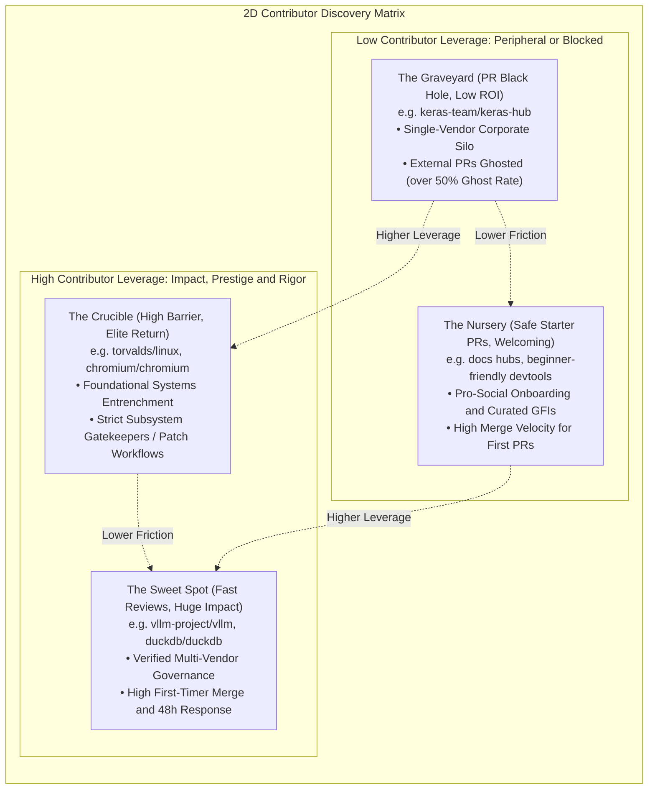
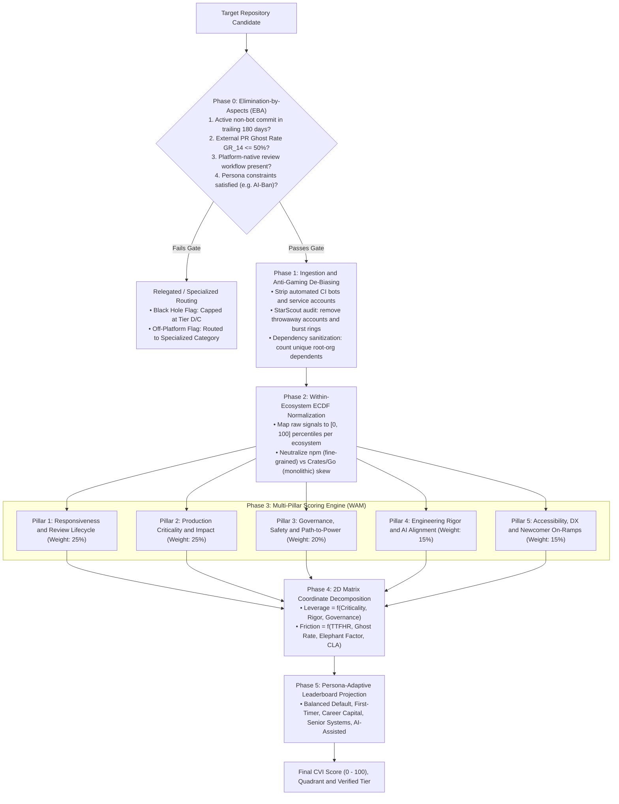

# Contributor Value Index (CVI) Platform
### Empirical Analytics Engine & 2D Discovery Matrix for Open-Source Software Contributors

---

## Executive Overview

The **Contributor Value Index (CVI) Platform** is an empirical analytics engine and discovery platform that evaluates open-source software (OSS) repositories worldwide based on **contributor return-on-investment (ROI)**.

Rather than relying on uncalibrated vanity metrics (stars, raw downloads), the platform models the trade-off between:
- **Contributor Leverage ($Y$-axis):** Long-term career capital, real-world production footprint, architectural rigor, and downstream dependency entrenchment.
- **Contributor Friction ($X$-axis):** Effective human review latency, PR ghosting rates, single-organization corporate gatekeeping (*CHAOSS Elephant Factor*), legal CLA exposure, and toxic maintainer interactions.

---

## Visual Platform Interfaces (Vector Design Assets)

### 1. The 2D Contributor Discovery Matrix & Scorecard Drawer
*Interactive spatial canvas decomposing Contributor Leverage ($Y$) vs. Contributor Friction ($X$) into four operational quadrants.*

### 2. Multi-Ecosystem Ranked Leaderboard & Filter Toolbar
*High-density tabular ranking across programming language ecosystems with sparklines, tier badges, and Stage 0 black hole warnings.*

### 3. Custom Priority & Dynamic Re-Ranking Configurator
*Interactive 5-pillar weighting sliders with lock-and-balance logic and real-time split-screen rank shift deltas (`▲ +14`, `▼ -4`).*

### 4. Deep-Dive Repository Scorecard Drawer
*Slide-over inspection drawer with 5-pillar radar polygon, Kaplan-Meier response latency survival curve, CHAOSS Elephant Factor breakdown, and active unclaimed GFIs.*

---

## The 2D Contributor Discovery Matrix

Repositories are evaluated across two orthogonal dimensions and classified into four operational quadrants:

---

## The 5-Phase Ranking Pipeline

---

## The 5 Evaluation Pillars (15 Empirical Parameters)

| Evaluation Pillar & Weight | Validated Parameters & Parameter Weights | Operational Definition & Scope |
| :--- | :--- | :--- |
| **Pillar 1: Responsiveness & Review Lifecycle (25%)** | • 1.1 Bot-Filtered Human TTFHR (35%) • 1.2 First-Timer Merge Rate MR_first (25%) • 1.3 PR Ghost Rate GR_14 (20%) • 1.4 PR Merge Latency Tail Risk TTM_p90 (20%) | Median response latency, external merge velocity, 14-day abandonment ceiling, and 90th percentile merge tail risk. |
| **Pillar 2: Production Criticality & Impact (25%)** | • 2.1 Downstream Registry Dependents (40%) • 2.2 Canonical OpenSSF Criticality Score (35%) • 2.3 Filtered Active Monthly Downloads (25%) | Real-world software ecosystem entrenchment, Rob Pike multi-signal criticality, and installer-filtered download volume. |
| **Pillar 3: Governance, Safety & Path-to-Power (20%)** | • 3.1 Legal IP Regime & Relicensing Safety (35%) • 3.2 CHAOSS Elephant Factor / Decentralization (35%) • 3.3 Contributor Promotion Ladder (30%) | IP protection against corporate relicensing traps (DCO vs. CLA), organizational decentralization, and non-sponsor maintainer pathways. |
| **Pillar 4: Engineering Rigor & AI Alignment (15%)** | • 4.1 OpenSSF Scorecard Pipeline Defenses (40%) • 4.2 Calibrated AI Policy Posture (35%) • 4.3 Review Depth & Substantive Guidance (25%) | Automated branch defenses and testing rigor, transparent AI policy governance, and balanced substantive inline code feedback. |
| **Pillar 5: Accessibility, DX & Newcomer On-Ramps (15%)** | • 5.1 Freshness of Unclaimed GFIs (40%) • 5.2 90-Day Newcomer Return Rate RR_90 (35%) • 5.3 Developer Experience & Setup Friction (25%) | Active unclaimed Good First Issues (< 30d), newcomer retention velocity, and reproducible devcontainer/CI execution runtime. |

---

## Comprehensive Documentation

- **[Architecture Specification (HLD & LLD)](docs/ARCHITECTURE.md):** Complete formal data contracts, Rob Pike canonical OpenSSF criticality procedural algorithms, ECDF normalization, StarScout fraud filters, DuckDB analytical lakehouse design, REST/GraphQL interface specifications, and verification test matrices.
- **[UI/UX Architecture & Design System](docs/UI_UX_SPECIFICATION.md):** Design tokens, 4 archetypal user personas, screen-by-screen layouts, interactive state machines, and WCAG 2.1 AA accessibility standards.

---

## License

This project is licensed under the Apache 2.0 License. See [LICENSE](LICENSE) for details.
