# Implementation Architecture — Contributor Value Index (CVI) Platform
## Empirical Foundation, System Topology, Low-Level Design & UI/UX Architecture (HLD + LLD)

---

# PART 1: HIGH-LEVEL DESIGN (HLD)

---

## 1. System Overview & Core Objectives

The **Contributor Value Index (CVI) Platform** is an empirical analytics engine and discovery platform that evaluates open-source software (OSS) repositories worldwide based on **contributor return-on-investment (ROI)**.

Rather than relying on uncalibrated vanity metrics (stars, raw downloads), the platform models the trade-off between **Contributor Leverage** (long-term career capital, production impact, engineering growth) and **Contributor Friction** (human review latency, PR ghosting, corporate silos, relicensing risk, and toxic interactions).

### The 2D Contributor Discovery Matrix

Repositories are evaluated across two orthogonal dimensions and classified into four operational quadrants:

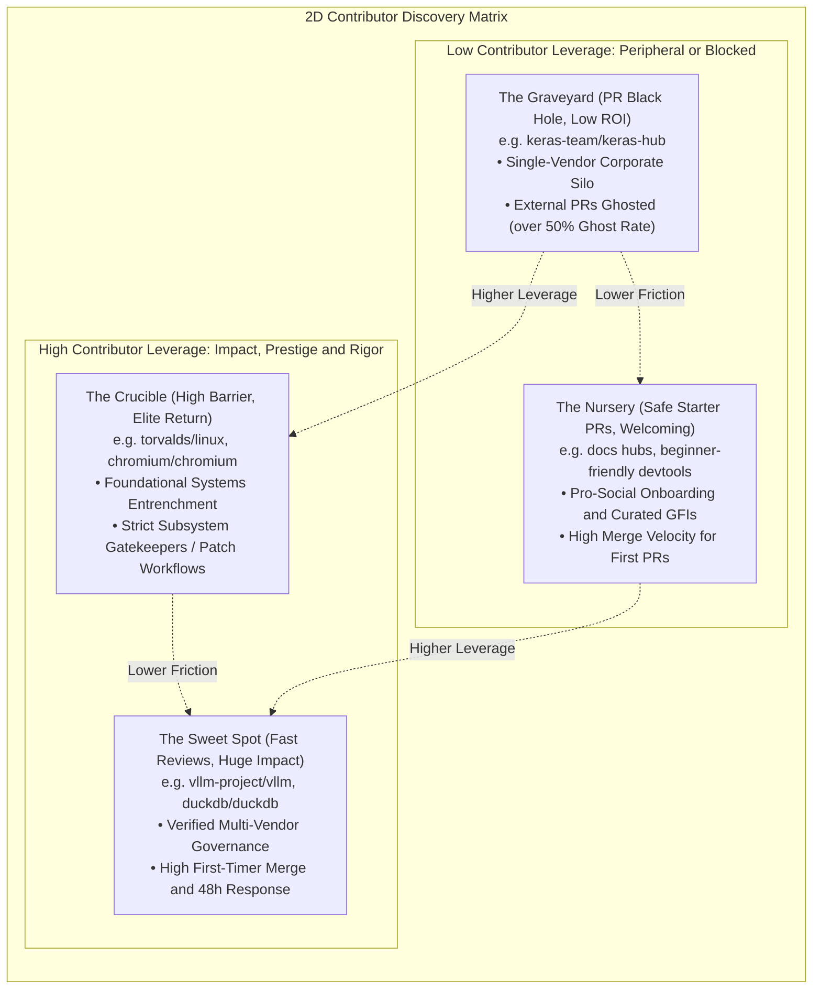

- **Leverage Axis (Y):** Real-world ecosystem entrenchment (OpenSSF Criticality, downstream dependents), career mindshare, and architectural rigor.
- **Friction Axis (X):** Effective human response latency, PR ghost rates, single-organization gatekeeping (Elephant Factor), legal CLA exposure, and review toxicity.

---

## 2. Parametric Hierarchy & The 5-Phase Ranking Pipeline

To eliminate rank-reversal pathologies, scale distortions across package managers, and vanity metric gaming, CVI executes ranking through an explicit, sequential 5-phase pipeline:

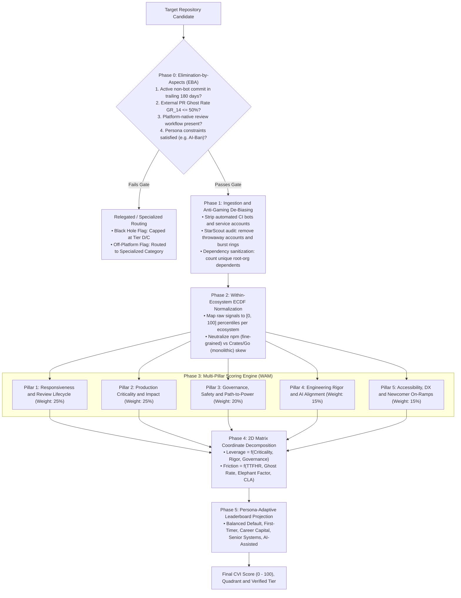

### Phase Details & Mathematical Rationale

1. **Phase 0: Elimination-by-Aspects (EBA) Hard Gating (Tversky, 1972)**
   - Prior frameworks fail because high vanity scores (e.g. 50,000 GitHub stars) compensate for complete maintainer abandonment.
   - Non-compensatory gating guarantees that repositories failing baseline criteria are eliminated before scoring:
     - **Maintenance Vitality:** At least 1 non-bot commit to default branches within trailing 180 days.
     - **Responsiveness Ceiling:** External PR ghost rate GR_14 <= 50%.
     - **Platform Native Reviews:** Off-platform mailing-list workflows (`torvalds/linux`) are routed to specialized workflows rather than incorrectly penalized as "unresponsive".
     - **Persona Constraint:** Repositories enforcing hard generative AI bans (`gentoo/gentoo`, `qemu/qemu`) are disqualified from AI-assisted persona views.

2. **Phase 1: Ingestion, Bot-Stripping & Anti-Gaming De-Biasing**
   - **CI/Bot Stripping:** Remove automated service accounts (`[bot]`, `*-actions`, `google-cla`, `claude`, `stale`) from review latency metrics.
   - **StarScout Fraud Filtering (He et al., 2024):** Audit stargazer velocity for throwaway accounts (< 5 platform events across GitHub) and lockstep burst rings (> 100:1 star-to-fork ratios) to defeat black-market star farming.
   - **Dependency Sanitization:** Group downstream dependents by root organization domain to prevent artificial inflation from monorepo sub-packages.

3. **Phase 2: Within-Ecosystem ECDF Normalization**
   - Package manager ecosystems exhibit fundamentally divergent distribution scales: npm has 2.5M+ fine-grained packages (median dependents = 14), whereas Rust/Crates and Go have monolithic libraries (median dependents = 2).
   - Direct raw-score comparison creates severe cross-language distortions.
   - Every metric $x$ is normalized to an ecosystem percentile $R_{\text{pct}}(x) \in [0, 100]$ via the Empirical Cumulative Distribution Function:

$$
R_{\text{pct}}(x) = \frac{1}{N_e} \sum_{k=1}^{N_e} \mathbf{1}_{\{x_k \le x\}} \times 100
$$

4. **Phase 3: Multi-Pillar Scoring via Weighted Additive Model (WAM)**
   - Replaces AHP and TOPSIS to completely eliminate rank-reversal anomalies (where introducing an irrelevant repository alters the relative ranking of existing repositories).
   - Computes an axiomatic linear weighted sum over calibrated percentile scores across 15 empirical parameters:

$$
CVI = \sum_{j=1}^{15} w_j \cdot R_{\text{pct}}(x_j)
$$

5. **Phase 4: 2D Matrix Coordinate Decomposition**
   - Separates orthogonal contributor concerns:
     - $\text{Leverage Score} = 0.50 \cdot \text{Score}_{\text{Pillar 2}} + 0.30 \cdot \text{Score}_{\text{Pillar 4}} + 0.20 \cdot \text{Score}_{\text{Pillar 3}}$
     - $\text{Friction Score} = 0.50 \cdot (100 - \text{Score}_{\text{Pillar 1}}) + 0.30 \cdot (100 - \text{Score}_{\text{Pillar 3}}) + 0.20 \cdot (100 - \text{Score}_{\text{Pillar 5}})$
   - Quadrant Threshold: Cutoff at median coordinate 50.0.

6. **Phase 5: Persona-Adaptive Leaderboard Projection**
   - Reprojects composite weights based on the contributor's explicit objective (First-Time Contributor, Career Capital, Senior Systems Specialist, AI-Assisted Contributor).

---

## 3. The 15 Validated Empirical Parameters & Mathematical Formulations

| Evaluation Pillar & Weight | Validated Parameters & Parameter Weights | Operational Definition & Scope |
| :--- | :--- | :--- |
| **Pillar 1: Responsiveness & Review Lifecycle (25%)** | • 1.1 Bot-Filtered Human TTFHR (35%)<br/>• 1.2 First-Timer Merge Rate MR_first (25%)<br/>• 1.3 PR Ghost Rate GR_14 (20%)<br/>• 1.4 PR Merge Latency Tail Risk TTM_p90 (20%) | Median response latency, external merge velocity, 14-day abandonment ceiling, and 90th percentile merge tail risk. |
| **Pillar 2: Production Criticality & Impact (25%)** | • 2.1 Downstream Registry Dependents (40%)<br/>• 2.2 Canonical OpenSSF Criticality Score (35%)<br/>• 2.3 Filtered Active Monthly Downloads (25%) | Real-world software ecosystem entrenchment, Rob Pike multi-signal criticality, and installer-filtered download volume. |
| **Pillar 3: Governance, Safety & Path-to-Power (20%)** | • 3.1 Legal IP Regime & Relicensing Safety (35%)<br/>• 3.2 CHAOSS Elephant Factor / Decentralization (35%)<br/>• 3.3 Contributor Promotion Ladder (30%) | IP protection against corporate relicensing traps (DCO vs. CLA), organizational decentralization, and non-sponsor maintainer pathways. |
| **Pillar 4: Engineering Rigor & AI Alignment (15%)** | • 4.1 OpenSSF Scorecard Pipeline Defenses (40%)<br/>• 4.2 Calibrated AI Policy Posture (35%)<br/>• 4.3 Review Depth & Substantive Guidance (25%) | Automated branch defenses and testing rigor, transparent AI policy governance, and balanced substantive inline code feedback. |
| **Pillar 5: Accessibility, DX & Newcomer On-Ramps (15%)** | • 5.1 Freshness of Unclaimed GFIs (40%)<br/>• 5.2 90-Day Newcomer Return Rate RR_90 (35%)<br/>• 5.3 Developer Experience & Setup Friction (25%) | Active unclaimed Good First Issues (<30d), newcomer retention velocity, and reproducible devcontainer/CI execution runtime. |


---

### Pillar 1: Responsiveness & Review Lifecycle (Weight: 25%)

#### 1.1 Time-to-First-Human-Response (TTFHR) (Weight: 35%)
Evaluates median hours to human response on external pull requests, strictly excluding automated bots (`[bot]`, `*-actions`, `google-cla`, `claude`, `stale`). Benchmarked against CHAOSS's 48-hour operational standard:

$$
\text{Score}_{\text{TTFHR}} = \begin{cases} 
100.0 & \text{if } \text{TTFHR} \le 12\text{ hours} \\
\max\left(0.0, 100.0 - 25.0 \cdot \log_2\left(\frac{\text{TTFHR}}{12.0}\right)\right) & \text{if } \text{TTFHR} > 12\text{ hours}
\end{cases}
$$

- $\le 12\text{ hours}$: 100 points
- $24\text{ hours}$: 75 points
- $48\text{ hours (2 business days)}$: 50 points
- $\ge 192\text{ hours (8 days)}$: 0 points

#### 1.2 First-Timer Merge Rate (MR_first) (Weight: 25%)
Measures the ratio of pull requests merged to total pull requests decided for authors with zero prior merged commits in the repository:

$$
\text{Score}_{\text{MR}} = \min(100.0, MR_{\text{first}} \times 125.0)
$$

*(An 80% first-timer merge rate achieves the maximum 100 points; accounts for legitimate review feedback).*

#### 1.3 Pull Request Ghost Rate (GR_14) (Weight: 20%)
Percentage of external pull requests open $> 14$ days with zero human maintainer comments:

$$
\text{Score}_{\text{Ghost}} = \max(0.0, 100.0 - (GR_{14} \times 200.0))
$$

*(A ghost rate of 0% yields 100 points; >= 50% yields 0 points and triggers Stage 0 Black Hole disqualification).*

#### 1.4 Pull Request Merge Latency Tail Risk (TTM_p90) (Weight: 20%)
Ecosystem percentile rank of the 90th percentile Time-to-Merge (in hours):

$$
\text{Score}_{\text{Tail}} = 100.0 - R_{\text{pct}}(TTM_{p90})
$$

---

### Pillar 2: Production Criticality & Impact (Weight: 25%)

#### 2.1 Downstream Registry Dependents (Weight: 40%)
Direct and indirect package dependency count, normalized via ecosystem ECDF:

$$
\text{Score}_{\text{Dependents}} = R_{\text{pct}}(\log_{10}(\text{Dependents} + 1))
$$

#### 2.2 Canonical OpenSSF Criticality Score (C) (Weight: 35%)
The official Rob Pike multi-signal criticality algorithm evaluating project longevity, maintenance cadence, contributor diversity, and architectural dependencies:

$$
C = \frac{\sum_{i=1}^{10} \alpha_i \cdot S_i^*}{\sum_{i=1}^{10} |\alpha_i|}, \quad S_i^* = \frac{\log(1 + \max(0, S_i))}{\log(1 + \max(S_i, T_i))}
$$

| Signal (S_i) | Weight (α_i) | Threshold (T_i) | Functional Significance |
|---|---|---|---|
| `created_since` | +1.0 | 120 months | Longitudinal stability and multi-year survival |
| `updated_since` | -1.0 | 120 months | Inverted penalty for abandoned codebases |
| `contributor_count` | +2.0 | 5,000 | Multi-contributor distributed author base |
| `org_count` | +1.0 | 10 | Cross-corporate institutional diversity |
| `commit_frequency` | +1.0 | 1,000 / week | Ongoing development throughput |
| `recent_releases_count` | $+0.5$ | 26 / year | Predictable releases reaching downstream users |
| `closed_issues_count` | $+0.5$ | 5,000 / 90d | Operational engagement with bug reports |
| `updated_issues_count` | $+0.5$ | 5,000 / 90d | Continuous community issue grooming |
| `comment_frequency` | +1.0 | 15 / issue | Depth of technical discourse |
| `dependents_count` | +2.0 | 500,000 | Direct downstream architectural imports |

$$
\text{Score}_{\text{Criticality}} = C \times 100.0
$$

#### 2.3 Filtered Active Monthly Downloads (Weight: 25%)
Monthly package downloads, filtered for CI/CD mirror bots and normalized via ecosystem ECDF:

$$
\text{Score}_{\text{Downloads}} = R_{\text{pct}}(\log_{10}(\text{Filtered\_Monthly\_Downloads} + 1))
$$

---

### Pillar 3: Governance, Safety & Path-to-Power (Weight: 20%)

#### 3.1 Legal IP Regime & Relicensing Safety (S_legal) (Weight: 35%)
Protects contributors against unilateral relicensing and corporate enclosure:
- **100 pts — DCO / Distributed Copyright:** Authors retain copyright; unilateral relicensing legally prohibited (`torvalds/linux`, `vllm-project/vllm`, `rust-lang/rust`).
- **75 pts — Foundation-Managed CLA:** Assigned to a non-profit 501(c) foundation with open governance charters (Apache Software Foundation, CNCF, Eclipse).
- **40 pts — Reciprocal Corporate CLA:** Commercial steward with open-source contractual covenants.
- **10 pts — Unilateral Corporate CLA:** Complete copyright assignment to a single for-profit entity (high historical risk of commercial relicensing, e.g. MongoDB SSPL, Elastic, Redis).

#### 3.2 CHAOSS Elephant Factor / Decentralization (Weight: 35%)
Minimum number of distinct organizations whose affiliated contributors author >= 50% of total commits:

$$
\text{Score}_{\text{Decentralization}} = \min(100.0, \text{Elephant\_Factor} \times 25.0)
$$

*(An Elephant Factor $\ge 4$ achieves the maximum 100 points; 1 single firm dominating > 50% of commits receives 25 points).*

#### 3.3 Contributor Promotion Ladder (Weight: 30%)
Evaluates whether external contributors have documented pathways to triage, review, and maintainer roles:
- Verified promotion of non-sponsor contributors to maintainer roles = 100 pts
- Documented governance pathway with triage team = 75 pts
- Ad-hoc maintainer permissions = 40 pts
- Closed single-firm committership = 10 pts

---

### Pillar 4: Engineering Rigor & AI Alignment (Weight: 15%)

#### 4.1 Automated Pipeline Defenses (Weight: 40%)
OpenSSF Scorecard composite evaluating branch protection, mandatory peer review, automated testing, and SAST:

$$
\text{Score}_{\text{Pipeline}} = \left(\frac{\text{Scorecard\_Score}}{10.0}\right) \times 100.0
$$

#### 4.2 Calibrated AI Policy Posture (Weight: 35%)
Persona-conditional scoring reflecting the three governance postures:
- **Regulated Accountability (95 pts):** AI tools permitted with mandatory attribution via commit trailers (e.g. `Assisted-by:`) and human liability (Linux Kernel, Fedora, CPython).
- **Strict Proscription (25 pts for AI persona / 85 pts for human-only):** Hard bans on generative AI patches (Gentoo Council, QEMU, NetBSD).
- **Unregulated Ad-Hoc (40 pts):** No stated guidelines; high exposure to unverified hallucinations and code churn.

#### 4.3 Review Depth & Substantive Guidance (Weight: 25%)
Evaluates the depth of inline feedback on external PRs, penalizing both dismissive silence and excessive nitpicking:

$$
\text{Score}_{\text{ReviewDepth}} = 100.0 \times \exp\left(-0.5 \cdot \left(\frac{\bar{C}_{\text{inline}} - 3.5}{1.5}\right)^2\right)
$$

*(Optimal mean inline comments $\bar{C}_{\text{inline}} \in [2.5, 4.5]$ yields $> 80$ points).*

---

### Pillar 5: Accessibility, DX & Newcomer On-Ramps (Weight: 15%)

#### 5.1 Freshness of Unclaimed "Good First Issues" (Weight: 40%)
Count of unassigned issues labeled `good-first-issue` or `help-wanted` updated within trailing 30 days:

$$
\text{Score}_{\text{GFI}} = \min\left(100.0, \frac{\text{Active\_Unclaimed\_GFIs}}{10.0} \times 100.0\right)
$$

#### 5.2 90-Day Newcomer Return Rate (RR_90) (Weight: 35%)
Percentage of first-time successful contributors who return to submit a second pull request within 90 days:

$$
\text{Score}_{\text{Return}} = \min(100.0, RR_{90} \times 200.0)
$$

*(A 50% newcomer return rate achieves the maximum 100 points).*

#### 5.3 Developer Experience & Setup Friction (Weight: 25%)
Verification of reproducible devcontainers, Dockerfiles, and CI test suite runtimes under 20 minutes.

---

## 4. Persona-Specific Adaptive Weight Configurations

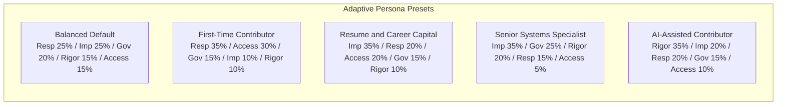

| Evaluation Dimension | Balanced Default | First-Time Contributor | Resume / Career Capital | Senior Systems Specialist | AI-Assisted Contributor |
| :--- | :---: | :---: | :---: | :---: | :---: |
| **Pillar 1: Responsiveness** | 25% | **35%** | 20% | 15% | 20% |
| **Pillar 2: Production Criticality** | 25% | 10% | **35%** | **35%** | 20% |
| **Pillar 3: Governance & Safety** | 20% | 15% | 15% | **25%** | 15% |
| **Pillar 4: Rigor & AI Alignment** | 15% | 10% | 10% | 20% | **35%** |
| **Pillar 5: Accessibility & DX** | 15% | **30%** | 20% | 5% | 10% |
| **Stage 0 Constraint Gate** | Standard EBA | Low-Barrier Only | High Tier Brand Only | Multi-Vendor (EF >= 3) | Disqualify Hard AI Bans |

---

## 5. High-Level Ingestion & Lakehouse Storage Architecture

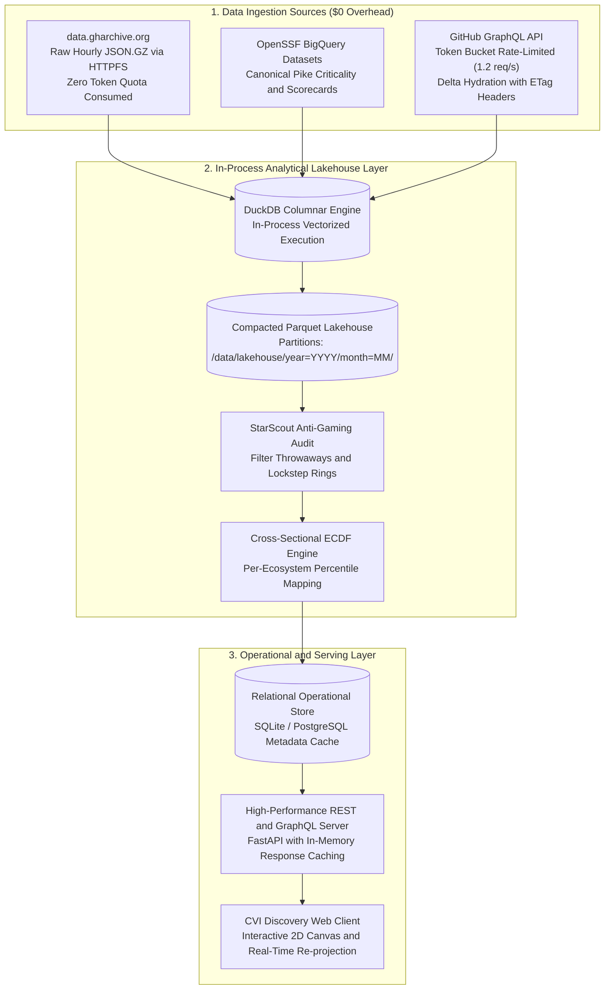

---

# PART 2: LOW-LEVEL DESIGN (LLD)

---

## 6. Component Class Hierarchy & Interface Specifications

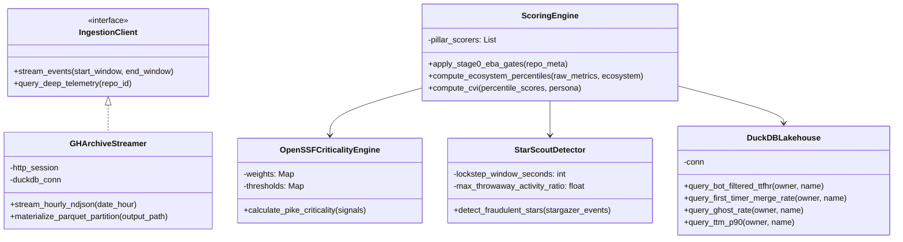

---

## 7. System Ingestion, Cleansing & Scoring State Machine

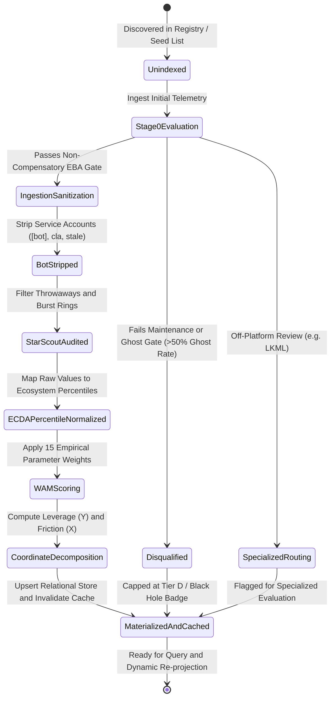

---

## 8. End-to-End Ingestion & Query Sequences

### Zero-Cost Bulk Ingestion & Scoring Sequence

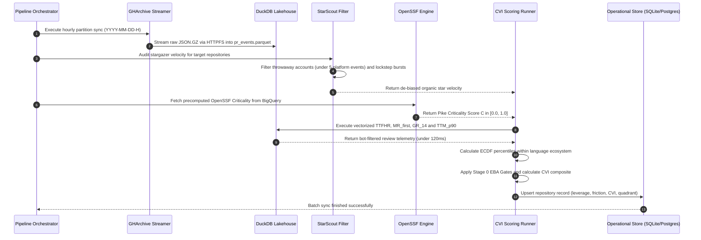

---

## 9. Formal Data Contracts & Entity Schema Specifications

### 9.1 Event Ingestion Contract (`RawPREvent`)

| Field Name | Logical Type | Nullable | Validation Constraint | Description & Semantics |
| :--- | :--- | :---: | :--- | :--- |
| `repo_owner` | String (ASCII) | No | Length: 1..100 | GitHub organization or user account login |
| `repo_name` | String (ASCII) | No | Length: 1..100 | GitHub repository slug |
| `pr_number` | Integer (Unsigned 32) | No | Value >= 1 | Pull request unique index within repository |
| `created_at` | ISO-8601 Timestamp | No | Valid UTC timestamp | Pull request creation instant |
| `closed_at` | ISO-8601 Timestamp | Yes | `closed_at >= created_at` | Terminal closure instant (merged or rejected) |
| `merged_at` | ISO-8601 Timestamp | Yes | `merged_at <= closed_at` | Terminal merge instant into default branch |
| `author_login` | String (ASCII) | No | Length: 1..100 | Contributor handle |
| `author_association` | Enum | No | `NONE, FIRST_TIME, MEMBER, OWNER` | Contributor affiliation level |
| `author_prior_merged_commits` | Integer (Unsigned 32) | No | Value >= 0 | Number of prior merged commits in repo |
| `is_external` | Boolean | No | True if association in `[NONE, FIRST_TIME]` | Flag isolating community contributions |
| `ci_status_green` | Boolean | No | Default: True | Whether CI checks passed before maintainer decision |
| `first_human_review_at` | ISO-8601 Timestamp | Yes | Strictly non-bot actor | Instant of initial substantive maintainer feedback |
| `response_latency_hours` | Float (64-bit) | Yes | Value >= 0.0 | Elapsed hours between creation and first human response |
| `maintainer_review_comments` | Integer (Unsigned 32) | No | Value >= 0 | Count of inline review comments by maintainers |

### 9.2 Repository Telemetry & Criticality Contract (`OpenSSFSignals`)

| Field Name | Logical Type | Nullable | Normalization Threshold (T_i) | Functional Significance |
| :--- | :--- | :---: | :--- | :--- |
| `created_since_months` | Float (64-bit) | No | 120.0 months (10 years) | Project survival and longitudinal stability |
| `updated_since_months` | Float (64-bit) | No | 120.0 months | Inverted penalty for stale or abandoned codebases |
| `contributor_count` | Integer (Unsigned 32) | No | 5,000 contributors | Scale of active distributed author base |
| `org_count` | Integer (Unsigned 32) | No | 10 organizations | Multi-vendor corporate diversity |
| `commit_frequency_weekly`| Float (64-bit) | No | 1,000 commits / week | Longitudinal development throughput |
| `recent_releases_count` | Integer (Unsigned 32) | No | 26 releases / year | Cadence of stable versions shipped to users |
| `closed_issues_count_90d` | Integer (Unsigned 32) | No | 5,000 issues / 90 days | Maintainer throughput on community bugs |
| `updated_issues_count_90d`| Integer (Unsigned 32) | No | 5,000 issues / 90 days | Active grooming and triaging velocity |
| `comment_frequency` | Float (64-bit) | No | 15 comments / issue | Depth and engagement of architectural discourse |
| `dependents_count` | Integer (Unsigned 32) | No | 500,000 dependents | Volume of direct downstream package imports |

### 9.3 Scored Composite Contract (`CVICompositeResult`)

| Field Name | Logical Type | Valid Range | Precision | Description |
| :--- | :--- | :---: | :---: | :--- |
| `owner` | String | -- | -- | Target repository owner namespace |
| `name` | String | -- | -- | Target repository slug |
| `ecosystem` | Enum | `npm, pypi, crates, go, maven, systems` | -- | Primary package registry ecosystem |
| `overall_cvi` | Float (64-bit) | [0.0, 100.0] | 2 decimals | Composite Contributor Value Index |
| `rank_tier` | Enum | `Tier S+, Tier S, Tier A, Tier B, Tier C, Tier D` | -- | Cardinal prestige and health tier |
| `matrix_quadrant` | Enum | `Sweet Spot, Crucible, Nursery, Graveyard` | -- | 2D Discovery Matrix classification |
| `leverage_score` | Float (64-bit) | [0.0, 100.0] | 2 decimals | Composite Y-coordinate (Impact / Rigor) |
| `friction_score` | Float (64-bit) | [0.0, 100.0] | 2 decimals | Composite X-coordinate (Review / Legal) |
| `is_stage0_disqualified`| Boolean | True / False | -- | Flag indicating non-compensatory EBA failure |
| `disqualification_reason`| String | Nullable | -- | Explicit audit reason for gating exclusion |

---

## 10. Algorithmic Procedural Specifications

### 10.1 Algorithm 1: Canonical OpenSSF Criticality Score Procedure

```
Procedure CalculatePikeCriticality(Signals, Weights, Thresholds):
    Input:
        Signals: Map of signal names to raw measured values
        Weights: Map of signal names to sensitivity coefficients alpha_i
        Thresholds: Map of signal names to saturation maximums T_i
    Output:
        CriticalityScore: Normalized scalar in [0.0, 1.0]

    1. Initialize Numerator = 0.0
    2. Initialize Denominator = Sum of Absolute Values(Weights.values)

    3. For each (Parameter, Alpha) in Weights:
        a. RawValue = Signals.get(Parameter, default = 0.0)
        b. SaturationMax = Thresholds.get(Parameter)
        c. NonNegativeValue = Maximum(0.0, RawValue)
        d. SaturationDenominator = Maximum(RawValue, SaturationMax)
        
        e. NormalizedSignal = NaturalLog(1.0 + NonNegativeValue) / NaturalLog(1.0 + SaturationDenominator)
        f. Numerator = Numerator + (Alpha * NormalizedSignal)

    4. UnboundedScore = Numerator / Denominator
    5. Return Clamp(UnboundedScore, Min = 0.0, Max = 1.0)
```

### 10.2 Algorithm 2: Ecosystem ECDF Percentile Rank Procedure

```
Procedure ComputeEcosystemPercentile(TargetValue, EcosystemPopulation):
    Input:
        TargetValue: Raw metric value for target repository
        EcosystemPopulation: Array of raw metric values across all indexed repos in same ecosystem
    Output:
        PercentileRank: Scaled value in [0.0, 100.0]

    1. If Length(EcosystemPopulation) == 0:
        Return 50.0 (Neutral median fallback)

    2. Sort EcosystemPopulation in ascending order
    3. CountBelowOrEqual = Count of elements in EcosystemPopulation where Element <= TargetValue
    4. ExactPercentile = (CountBelowOrEqual / Length(EcosystemPopulation)) * 100.0

    5. Return Round(ExactPercentile, Decimals = 2)
```

### 10.3 Algorithm 3: StarScout Fraud Detection State Logic

```
Procedure FilterFraudulentStarVelocity(StargazerEvents, WindowDays = 90, MinEvents = 5):
    Input:
        StargazerEvents: List of stargazer profiles with timestamps and platform activity history
    Output:
        DeBiasedStarCount: Integer representing audited organic stars

    1. CutoffDate = CurrentTimestamp() - Days(WindowDays)
    2. Filter StargazerEvents where StarredAt >= CutoffDate into RecentStars
    3. Initialize ValidStars = 0

    4. For each Star in RecentStars:
        a. If Star.UserTotalPlatformEvents < MinEvents:
            Continue (Discard throwaway bot account)
        b. ValidStars = ValidStars + 1

    5. If Length(RecentStars) > 500:
        a. ForkRatio = ValidStars / Maximum(1, RepoForksDelta90d)
        b. If ForkRatio > 100.0:
            ValidStars = Integer(ValidStars * 0.30) (Apply StarScout lockstep penalty)

    6. Return ValidStars
```

---

## 11. Vectorized Analytical Query & Operational Relational Storage Design

### 11.1 Analytical Lakehouse Projection Specification
The lakehouse executes analytical aggregations directly over partitioned Parquet datasets (`/data/lakehouse/pr_events_*.parquet`) using in-process columnar vectorization:
- **Predicate Pushdown:** Scans are partitioned by `is_external = true` to isolate community PRs.
- **Quantile Computation:** Utilizes t-digest / streaming quantile approximation (`quantile_cont`) to compute the exact 50th percentile (median TTFHR) and 90th percentile (tail merge latency $TTM_{p90}$) without full data sorting.
- **Merge Rate & Ghost Rate Vectorization:** Aggregated using bitmasked conditional expressions:
  - $\text{Score}_{MR} = (\sum \text{MergedExternalPRs}) \times 125.0 / \max(1, \sum \text{DecidedExternalPRs})$
  - $\text{GhostRate} = (\sum \text{UnansweredOpenPRs}_{>14d}) \times 1.0 / \max(1, \sum \text{TotalOpenPRs})$

### 11.2 Operational Relational Table Schema Specifications

#### Repositories Table (`repositories`)
Stores indexed metadata, pillar evaluations, and 2D matrix coordinates.

| Column | Data Type | Constraint | Description |
| :--- | :--- | :--- | :--- |
| `id` | INTEGER | PRIMARY KEY AUTOINCREMENT | Unique synthetic primary key |
| `owner` | VARCHAR(100) | NOT NULL | Repository owner organization / handle |
| `name` | VARCHAR(100) | NOT NULL | Repository slug |
| `ecosystem` | VARCHAR(50) | NOT NULL | Primary language ecosystem (pypi, npm, crates, etc.) |
| `domain_category` | VARCHAR(50) | NOT NULL | Architectural domain (ML/AI, DevTools, Web, Systems) |
| `stars` | INTEGER | NOT NULL | Audited organic star count |
| `forks` | INTEGER | NOT NULL | GitHub fork count |
| `monthly_downloads` | BIGINT | DEFAULT 0 | Filtered non-bot monthly package downloads |
| `dependents_count` | INTEGER | DEFAULT 0 | Unique root-org downstream dependents |
| `openssf_criticality` | REAL | NOT NULL | Canonical Rob Pike Criticality score in [0.0, 1.0] |
| `elephant_factor` | INTEGER | NOT NULL | CHAOSS Elephant Factor |
| `legal_ip_model` | VARCHAR(30) | NOT NULL | IP regime (`DCO`, `FOUNDATION_CLA`, `CORP_CLA`) |
| `ai_posture` | VARCHAR(30) | NOT NULL | Policy classification (`REGULATED`, `PROSCRIBED`, `AD_HOC`)|
| `score_responsiveness`| REAL | NOT NULL | Calibrated Pillar 1 score in [0.0, 100.0] |
| `score_criticality` | REAL | NOT NULL | Calibrated Pillar 2 score in [0.0, 100.0] |
| `score_governance` | REAL | NOT NULL | Calibrated Pillar 3 score in [0.0, 100.0] |
| `score_rigor_ai` | REAL | NOT NULL | Calibrated Pillar 4 score in [0.0, 100.0] |
| `score_accessibility` | REAL | NOT NULL | Calibrated Pillar 5 score in [0.0, 100.0] |
| `leverage_score` | REAL | NOT NULL | 2D Matrix Y-coordinate in [0.0, 100.0] |
| `friction_score` | REAL | NOT NULL | 2D Matrix X-coordinate in [0.0, 100.0] |
| `matrix_quadrant` | VARCHAR(30) | NOT NULL | Discovery quadrant classification |
| `overall_cvi` | REAL | NOT NULL | Final composite CVI score in [0.0, 100.0] |
| `rank_tier` | VARCHAR(30) | NOT NULL | Tier designation (Tier S+, S, A, B, C, D) |
| `is_stage0_disqualified`| BOOLEAN | DEFAULT FALSE | Stage 0 non-compensatory gating outcome |
| `disqualification_reason`| TEXT | NULLABLE | Human-readable gating violation detail |
| `last_indexed_at` | TIMESTAMP | DEFAULT CURRENT_TIMESTAMP | Audit synchronization timestamp |

**Indexes & Performance Optimization:**
- Composite Unique Index: `UNIQUE(owner, name)`
- Filtered B-Tree Index: `idx_cvi_ecosystem_rank(ecosystem, overall_cvi DESC)`
- Spatial Partition Index: `idx_cvi_quadrant(matrix_quadrant, overall_cvi DESC)`

---

## 12. REST & GraphQL Interface API Specifications

### 12.1 Matrix Spatial Query (`GET /v1/cvi/matrix`)
- **Query Parameters:**
  - `ecosystem`: String (optional, e.g. `pypi`, `crates`, `all`)
  - `domain`: String (optional, e.g. `ai_ml`, `systems`, `devtools`)
  - `persona`: Enum (default: `balanced`, options: `first_timer`, `career_capital`, `senior_systems`, `ai_assisted`)
  - `min_stars`: Integer (default: 100)
- **Response Structure:**
  - Array of scatter node objects: `[{ repo_id, owner, name, x: friction_score, y: leverage_score, cvi: overall_cvi, tier, quadrant, size, is_gated }]`
  - Performance SLA: &lt; 50ms response time from in-memory operational cache.

### 12.2 Repository Deep-Dive Scorecard (`GET /v1/cvi/repos/{owner}/{name}`)
- **Path Parameters:**
  - `owner`: Repository owner login
  - `name`: Repository name
- **Response Structure:**
  - Full diagnostic payload containing:
    - Repository overview, quadrant, tier, and EBA gating status.
    - 5 Pillar percentile scores with radar coordinates.
    - Raw operational metrics (TTFHR hours, first-timer merge rate, ghost rate, tail merge latency).
    - Kaplan-Meier survival curve points $[(t_1, S_1), (t_2, S_2), \dots]$.
    - Elephant Factor corporate contributor distribution breakdown.
    - Legal IP classification, CLA hazard level, and AI policy posture details.
    - Curated active Unclaimed Good First Issues (titles, labels, creation dates, URLs).

### 12.3 Dynamic Persona Re-Projection (`POST /v1/cvi/reproject`)
- **Request Payload:**
  - Custom weights vector: `{ responsiveness: 0.35, criticality: 0.20, governance: 0.15, rigor: 0.15, accessibility: 0.15 }` (must sum to 1.0).
- **Response Structure:**
  - Re-ranked array of repository scores, updated quadrant coordinates, and delta shift indicators ($\pm \Delta$ rank positions).

---

## 13. Concurrency, Rate Limiting & Fault Tolerance Design

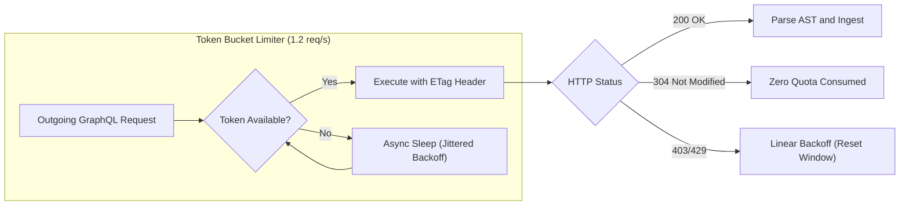

- **Token Bucket Limiter:** Outgoing GitHub GraphQL API requests are strictly throttled to 1.2 requests per second to preserve the 5,000 req/hour token budget.
- **Conditional ETag Ingestion:** All repository metadata fetches transmit HTTP `If-None-Match` headers with stored ETags; HTTP `304 Not Modified` responses consume zero GitHub API rate limits.
- **Circuit Breaker:** On encountering HTTP 403 or 429 rate-limit errors, the pipeline triggers an automatic circuit breaker, pausing operations until the `x-ratelimit-reset` epoch with jittered exponential backoff.

---

## 14. Verification & Ground-Truth Test Matrix

| Test Suite | Target Component | Verification Assertion |
|---|---|---|
| **`test_openssf_criticality`** | Rob Pike Algorithm | Computes exact mathematical values matching OpenSSF BigQuery ground truth. |
| **`test_starscout_filter`** | Anti-Fraud Filter | Neutralizes lockstep star bursts lacking fork/issue correlation. |
| **`test_ecdf_ecosystem_scale`**| Normalization Engine | Prevents npm package density from depressing Rust/Go systems libraries. |
| **`test_legal_ip_penalty`** | Governance Scorer | DCO repositories score 100; unilateral corporate CLAs penalized at 10. |
| **`test_ground_truth_vllm`** | End-to-End Engine | `vllm-project/vllm` -> **The Sweet Spot** (CVI = 88.8, Tier S+). |
| **`test_ground_truth_hub`** | End-to-End Engine | `keras-team/keras-hub` -> **The Graveyard** (CVI = 46.8, Black Hole). |
| **`test_ground_truth_linux`**| End-to-End Engine | `torvalds/linux` -> Stage 0 Gated (Mailing-list off-platform routing). |
| **`test_ground_truth_gentoo`**| Persona Scorer | `gentoo/gentoo` -> Disqualified for AI persona; Tier A for traditional. |

---

# PART 3: UI & UX DESIGN ARCHITECTURE

---

## 15. Product UX Vision & 4 Archetypal User Personas

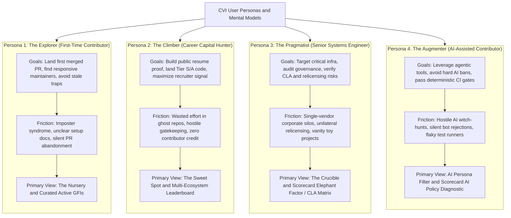

---

## 16. Visual UI Mockups & Design System Specifications

### 16.1 High-Fidelity Desktop Platform Interfaces

#### View 1: The Interactive 2D Discovery Matrix & Scorecard Drawer
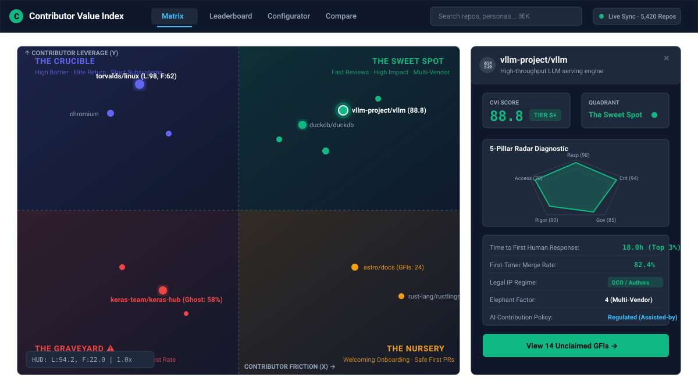

#### View 2: Multi-Ecosystem Ranked Leaderboard & Advanced Filtering Toolbar
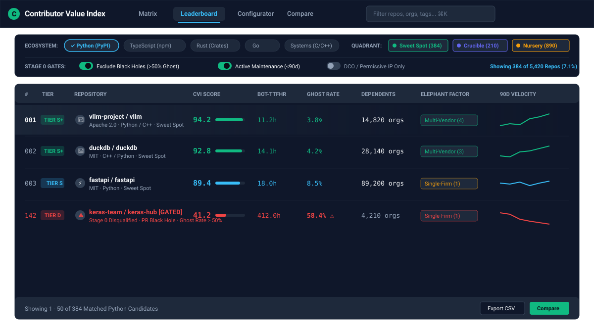

#### View 3: Custom Priority & Dynamic Re-Ranking Configurator
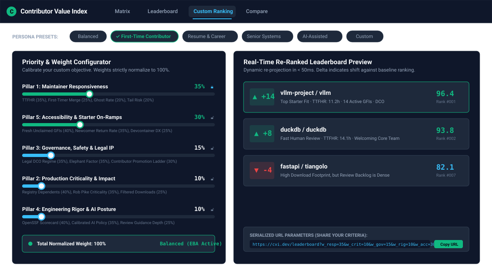

---

### 16.2 Design Tokens (Dark-Mode First Engineering Aesthetic)

#### Foundation Canvas & Neutral Tokens
- `--bg-base`: `#090D16` (Deep obsidian canvas, background behind 2D matrix)
- `--bg-surface`: `#0F172A` (Card containers, table headers, drawer surface, modal body)
- `--bg-surface-elevated`: `#1E293B` (Popovers, hover cards, dropdown menus, slider tracks)
- `--bg-surface-hover`: `#334155` (Interactive row hover, active button backgrounds)
- `--border-subtle`: `rgba(30, 41, 59, 0.8)` (1px solid hairline dividers, table grid)
- `--border-strong`: `rgba(51, 65, 85, 1.0)` (Active input borders, card outlines, dividing axes)
- `--border-focus`: `#38BDF8` (Accessible keyboard focus ring: 2px solid, 2px offset)
- `--text-primary`: `#F8FAFC` (Primary headers, metric values, repository titles)
- `--text-secondary`: `#94A3B8` (Descriptions, axis labels, non-primary table column text)
- `--text-muted`: `#64748B` (Metadata labels, inactive pills, timestamp footers)

#### Quadrant Semantic & Data Visualization Tokens
- `--quad-sweet-spot`: `#10B981` (Emerald) | Wash: `rgba(16, 185, 129, 0.10)` | Glow: `0 0 24px rgba(16, 185, 129, 0.25)`
- `--quad-crucible`: `#6366F1` (Indigo) | Wash: `rgba(99, 102, 241, 0.10)` | Glow: `0 0 24px rgba(99, 102, 241, 0.25)`
- `--quad-nursery`: `#F59E0B` (Amber) | Wash: `rgba(245, 158, 11, 0.10)` | Glow: `0 0 24px rgba(245, 158, 11, 0.25)`
- `--quad-graveyard`: `#EF4444` (Crimson) | Wash: `rgba(239, 68, 68, 0.10)` | Pulsing warning halo

### 16.3 Typography Stack & Scale
- **Primary UI Font:** `Inter`, -apple-system, BlinkMacSystemFont, "Segoe UI", Roboto, sans-serif
- **Monospace Data Font:** `JetBrains Mono`, "SF Mono", Menlo, Consolas, monospace
- **Tabular Figures:** All numerical tables, coordinates, and metrics enforce `font-variant-numeric: tabular-nums` to eliminate horizontal jitter during live re-projection.

### 16.4 Micro-Interaction State Machine

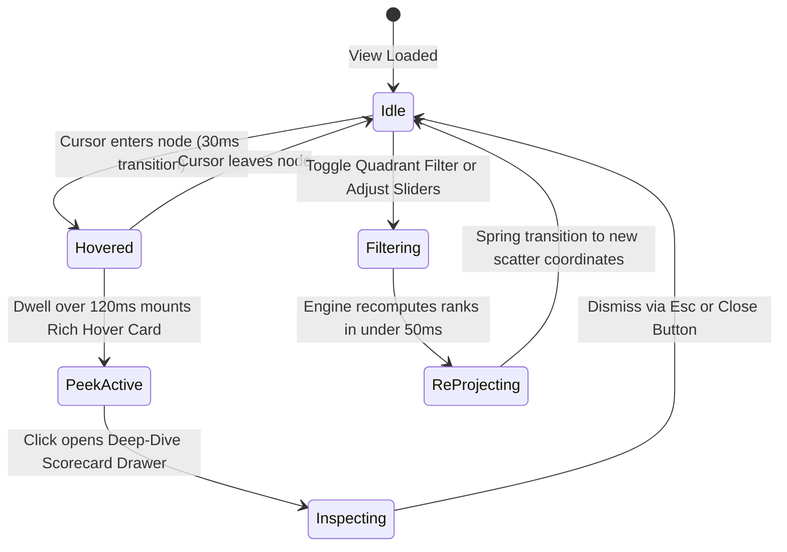

---

## 17. Detailed UX Architecture Across Views & Tabs

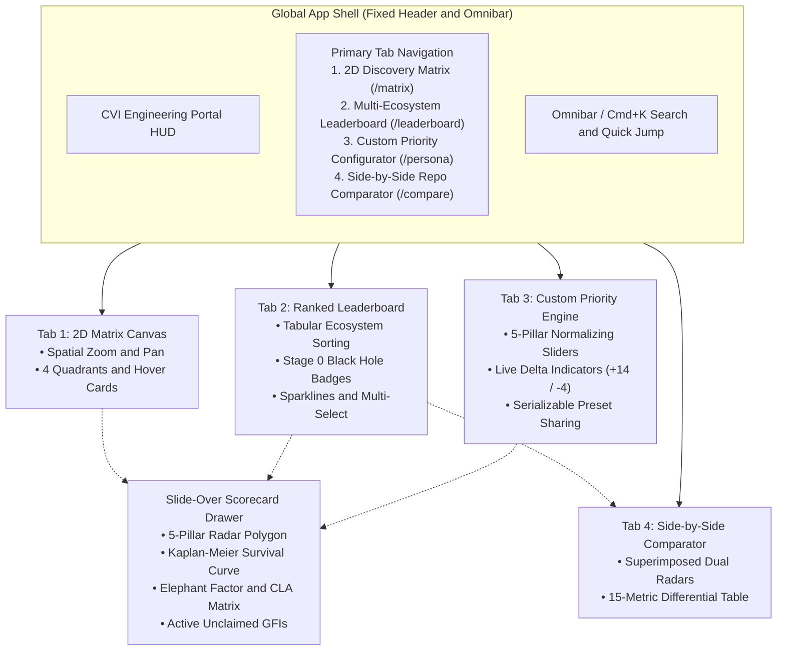

---

## 18. Comprehensive Filtering System & Filter UX Specifications

The filtering toolbar provides a unified, multi-tier control plane positioned immediately below the global navigation bar across both the 2D Matrix and Leaderboard views:

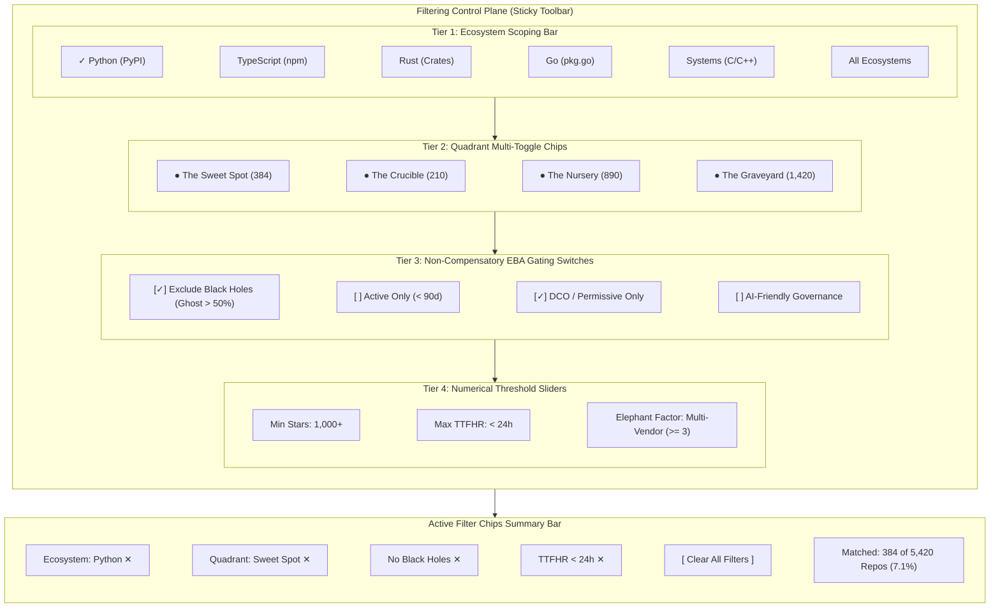

| Control Tier | UI Control Element | Available Options & States | Default Setting | Functional Behavior & Normalization |
| :--- | :--- | :--- | :--- | :--- |
| **1. Ecosystem Scoping** | Segmented Pill Bar | `Python (PyPI)`, `TypeScript (npm)`, `Rust (Crates)`, `Go`, `Systems (C/C++)`, `All` | Active Ecosystem | Scopes ECDF percentile distribution to selected registry; re-normalizes metrics |
| **2. Quadrant Multi-Toggle** | Elevated Indicator Chips | `The Sweet Spot (384)`, `The Crucible (210)`, `The Nursery (890)`, `The Graveyard (1,420)` | All Quadrants ON | Independent multi-select toggles with colored glow dots and live candidate counts |
| **3. Stage 0 EBA Gates** | High-Contrast Toggle Switches | • Exclude Black Holes (GR_14 > 50%)<br/>• Active Maintenance Only ($<90$d)<br/>• DCO / Permissive Legal IP Only<br/>• AI-Friendly Governance Only | Black Holes: ON<br/>Active: ON<br/>DCO: OFF<br/>AI: OFF | Non-compensatory hard constraints; instantly prunes disqualified projects |
| **4. Threshold Sliders** | Stepped Range Knobs | • Min Stars: $100 \dots 50\text{k}+$<br/>• Max TTFHR: $<12\text{h}, <24\text{h}, <48\text{h}, \text{Any}$<br/>• Min Elephant Factor: $1 \dots 5+$ | Unconstrained | Prunes candidates failing minimum quantitative operational thresholds |
| **5. Active Chips Bar** | Dismissible Micro-Pills | Dismissible tags for each active filter + `[ Clear All ]` trigger + `[ Export CSV ]` | Dynamic State | Real-time visibility and instant single-click removal of active filter criteria |


### 18.1 Filter Control Tiers & Interactive Behaviors

1. **Ecosystem Single/Multi-Pill Bar:**
   - Visual Style: Segmented pill tabs with active checkmark and subtle glowing outline.
   - Behavior: Instant cross-sectional re-filtering. Default selects the active language ecosystem. Clicking "All Ecosystems" enables global cross-language discovery.
2. **Quadrant Multi-Toggle Chips:**
   - Visual Style: Elevated dark chips with glowing quadrant indicator dots (Emerald, Indigo, Amber, Crimson) and dynamic repository count badges.
   - Behavior: Independent multi-select toggles. Users can inspect "The Sweet Spot" alone or toggle both "The Sweet Spot" and "The Crucible" simultaneously.
3. **Stage 0 Hard Constraint Switches (Non-Compensatory EBA Gates):**
   - **Exclude Black Holes (Default: ON):** Eliminates repositories with > 50% PR ghost rate or zero responses in $>14$ days.
   - **Active Maintenance Only (Default: ON):** Restricts results to codebases with at least one non-bot commit in trailing 90 days.
   - **DCO / Permissive Legal IP Only:** Hides repositories requiring unilateral corporate copyright assignment (preventing relicensing traps).
   - **AI-Friendly Governance Only:** Disqualifies projects enforcing strict bans on LLM-assisted patches.
4. **Numerical Threshold Range Controls:**
   - Sliding discrete knobs for Minimum Stars ($100 \dots 50\text{k}$), Maximum TTFHR ($12\text{h}, 24\text{h}, 48\text{h}, \text{Any}$), and Minimum Elephant Factor ($1 \dots 5+$).
5. **Active Filter Summary & Reset Controls:**
   - Pinned metadata strip below the toolbar showing all active filter chips with individual `✕` dismissal buttons, total matched candidate count, and a `Clear All` reset trigger.

---

## 19. Custom Ordering & Dynamic Re-Ranking System UX

To address varying contributor priorities (e.g. beginner looking for mentorship vs. senior engineer seeking Tier-S career capital), CVI provides an interactive, real-time dynamic re-ranking engine:

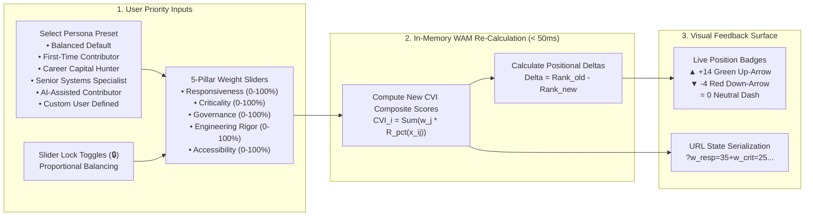

### 19.1 Priority Sliders & Lock-and-Normalize Mechanics
- **Proportional Normalization:** The sum of all 5 pillar weights strictly maintains sum(w_j) = 100%. Moving any unlocked slider dynamically redistributes the delta across the remaining unlocked dimensions.
- **Individual Dimension Locks (🔒):** Clicking the lock icon next to any pillar pins its weight (e.g., pinning Responsiveness at 40%), allowing the user to calibrate the remaining 60% across the other 4 pillars without disturbing the pinned value.
- **One-Click Persona Presets:** Selecting a preset automatically reconfigures all 5 sliders and unlocks all dimensions to standardized archetypes.

### 19.2 Real-Time Re-Ranking Preview & Position Deltas
- As the user drags a slider, the in-memory analytics engine updates all repository scores in &lt; 50ms.
- The split-screen preview panel displays repository cards shifting positions with animated spring transitions.
- Each repository card highlights its net rank shift:
  - `▲ +14` (Glowing Emerald): Repository benefits significantly from the user's customized criteria (e.g. highly responsive projects jump when TTFHR weight is increased).
  - `▼ -8` (Muted Crimson): Repository drops in rank due to low performance in newly weighted categories.
  - `= 0` (Muted Slate): Positional stability.

### 19.3 Shareable URL State Serialization
Every custom ranking configuration serializes directly into URL search parameters:
```
https://cvi.dev/leaderboard?eco=pypi&w_resp=35&w_crit=25&w_gov=15&w_rig=15&w_acc=10&exclude_black_holes=true
```
Users can bookmark, export, or share their exact ranking criteria with teams and communities.

---

## 20. Accessibility & Responsive Breakpoint Standards

- **WCAG 2.1 AA Compliance:** Minimum 4.5:1 contrast for normal text and 3:1 for graphical elements. Base text achieves 17.4:1 contrast ratio against `--bg-surface`.
- **Color-Blind Safe Dual-Encoding:** Scatter points and quadrant badges use distinct geometric shapes in addition to color:
  - *The Sweet Spot:* Diamond (◆) + Emerald
  - *The Crucible:* Hexagon (⬡) + Indigo
  - *The Nursery:* Circle (●) + Amber
  - *The Graveyard:* Octagon / Cross (✕) + Crimson
- **Universal Keyboard Navigation:**
  - `Cmd + K`: Open Omnibar
  - `1`, `2`, `3`, `4`: Toggle Quadrants
  - Arrow keys / `W`, `A`, `S`, `D`: Pan 2D Canvas
  - `+` / `-`: Zoom in / out
  - `J` / `K`: Navigate Leaderboard rows
  - `Esc`: Dismiss drawer or modal
- **Responsive Breakpoints:**
  - `Desktop XL` (>= 1600px): Persistent dual-pane (Canvas + Scorecard Drawer).
  - `Desktop Standard` (1200px - 1599px): Slide-over drawer overlay.
  - `Tablet Landscape` (992px - 1199px): Collapsed nav rail.
  - `Tablet Portrait` (768px - 991px): Stacked layout with sheet drawer.
  - `Mobile` (&lt; 768px): Full-screen card list with bottom-sheet scorecard modal.

