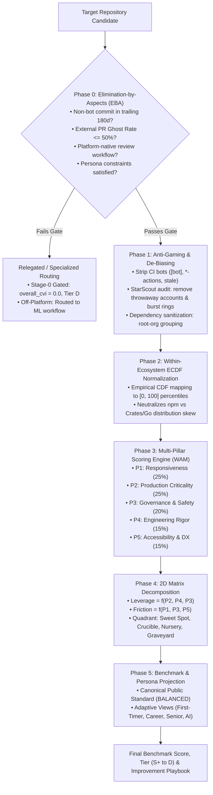
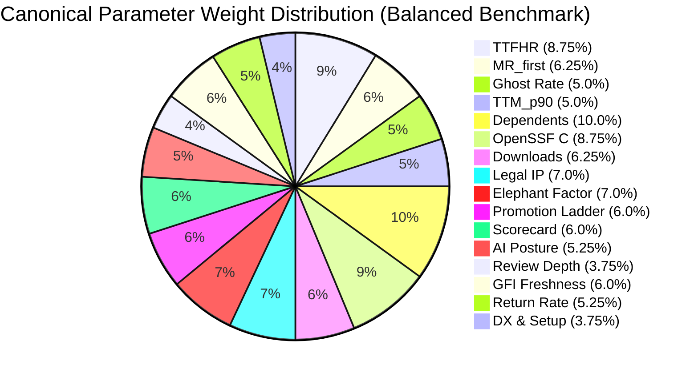
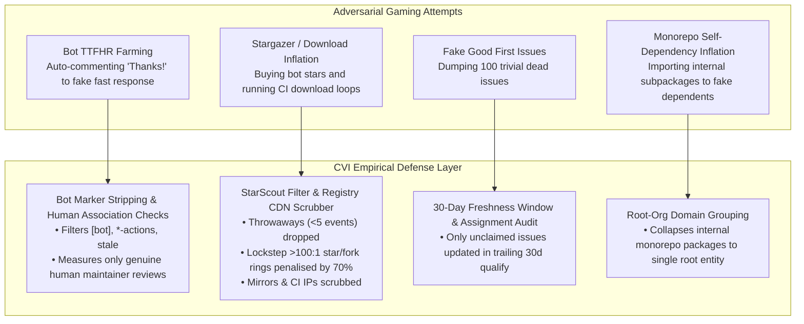

# Contributor Value Index (CVI) — Empirical Foundation & Benchmark Standard

## The Axiomatic, Mathematical & Empirical Specification of the Global Open-Source Contributor Benchmark

---

### Abstract & Problem Formulation: Why Software Benchmarks Fail

Most developer analytics tools and repository rankings degenerate into **"vanity metrics"** or **"AI slop"**:
1. **Vanity Metric Conflation:** Equating consumer popularity (GitHub stars, forks) with contributor return-on-investment (ROI). A 60,000-star repository where community pull requests sit unreviewed for 9 months is not a premier engineering opportunity; it is an empirical **PR Black Hole** that wastes developer hours.
2. **Compensatory Pathologies:** In traditional Weighted Additive Models without non-compensatory gates, high vanity scores compensate for total community abandonment (e.g., $100,000\text{ stars} \times 0.20$ outweighs an unresponsive, abandoned maintenance team).
3. **Cross-Ecosystem Scale Distortion:** Ecosystem distributions diverge by orders of magnitude. The median npm package has 14 downstream dependents (due to micro-packaging culture), whereas the median Go or Rust library has 2. Direct comparison across languages without rigorous within-ecosystem normalization introduces severe architectural bias.
4. **Rank-Reversal Anomalies:** Multi-criteria decision frameworks like AHP (Analytic Hierarchy Process) or TOPSIS suffer from Arrow's Impossibility Theorem: introducing an irrelevant, low-scoring repository alters the relative rank between two elite repositories.
5. **Absence of Maintainer Agency:** Arbitrary rankings produce grades without causal gradients. If a benchmark cannot provide a mathematically provable gradient $\nabla \text{CVI}$ showing which specific operational levers move the score and why, it is unscientific and cannot guide community improvement.

The **Contributor Value Index (CVI)** is constructed to resolve these exact failure modes through an axiomatic 5-phase evaluation pipeline grounded in empirical software engineering research (Gousios et al., Storey et al., Rob Pike, CHAOSS, He et al.).

---

### 1. The 5-Phase Axiomatic Ranking Pipeline

---

### 2. Phase 0: Non-Compensatory Gating (Tversky's EBA)

Traditional scoring systems fail because they are purely compensatory. In CVI, **Phase 0 executes Tversky's Elimination-by-Aspects (1972)**: repositories failing non-negotiable baseline viability are eliminated before scoring:

| Gate | Empirical Aspect | Mathematical Criterion | Failure Outcome | Scientific Rationale |
|---|---|---|---|---|
| **Gate 1: Vitality** | Active Maintenance | $\text{Commits}_{\text{180d}} \ge 1$ (non-bot to default branch) | Relegated to `Tier.D`, `cvi = 0.0` | Repositories with no commits in 6 months are abandoned. Contributing has near-zero merge probability. |
| **Gate 2: Black Hole** | Community Abandonment | $\text{Ghost Rate } GR_{14} \le 50.0\%$ | Relegated to `Tier.D`, `cvi = 0.0`, `is_black_hole = True` | A repository ignoring $> 50\%$ of community PRs for $> 14\text{ days}$ consumes developer hours without reciprocity. |
| **Gate 3: Workflow** | Platform Reviews | $\text{Reviews}_{\text{platform}} = \text{True}$ | Routed to Specialized Workflow (`is_off_platform = True`) | Prevents penalizing mailing-list workflows (`torvalds/linux`, `git/git`) as "unresponsive GitHub repos". |
| **Gate 4: Persona** | Multi-Vendor Governance | $\text{Elephant Factor } EF \ge 3$ (Senior Systems only) | Disqualified under Senior Systems View | Protects senior infrastructure contributors from single-vendor commercial capture. |
| **Gate 5: AI Posture** | Generative AI Ban | $\text{AI Posture} \ne \text{PROSCRIBED}$ (AI Persona only) | Disqualified under AI-Assisted View | Prevents contributors using AI developer tools from wasting time on projects enforcing hard AI bans (`gentoo`, `qemu`). |

---

### 3. The Canonical Parameter Hierarchy & Calibrated Formulations

The Canonical Global Benchmark is evaluated under the **Balanced Standard** across **5 Pillars and 16 Parameters** ($\sum w_i = 1.0$):

$$\text{CVI}_{\text{Canonical}} = \sum_{j=1}^{16} w_j \cdot R_{\text{pct}}(x_j)$$

---

#### Pillar 1: Responsiveness & Review Lifecycle (Global Weight: 25%)
*Empirical Foundation:* Empirical software engineering literature (Storey et al., Gousios et al. ICSE 2014) demonstrates that maintainer review latency is the single strongest predictor of whether an external contributor continues contributing.

1. **Bot-Filtered Human TTFHR (Weight: 35% of P1 $\rightarrow$ 8.75% Global):**
   - Strictly strips automated bots (`[bot]`, `*-actions`, `google-cla`, `claude`, `stale`) from comment author lists.
   - Evaluates median hours to first human response using a logarithmic half-life decay benchmarked to the CHAOSS 48-hour standard:

   $$\text{Score}_{\text{TTFHR}} = \begin{cases} 
   100.0 & \text{if } \text{TTFHR} \le 12.0\text{ h} \\
   \max\left(0.0, 100.0 - 25.0 \cdot \log_2\left(\frac{\text{TTFHR}}{12.0}\right)\right) & \text{if } \text{TTFHR} > 12.0\text{ h}
   \end{cases}$$

   - $\le 12\text{h}$: $100\text{ pts}$ (elite turnaround)
   - $24\text{h}$: $75\text{ pts}$
   - $48\text{h}$ (2 business days): $50\text{ pts}$
   - $\ge 192\text{h}$ (8 days): $0\text{ pts}$

2. **First-Timer Merge Rate $MR_{\text{first}}$ (Weight: 25% of P1 $\rightarrow$ 6.25% Global):**
   - Ratio of external newcomer PRs merged to total newcomer PRs decided (authors with 0 prior merged commits).
   - Linear clamp reaching 100 points at 80% merge rate:

   $$\text{Score}_{\text{MR}} = \min(100.0, MR_{\text{first}} \times 125.0)$$

   *Design Rationale:* Capping at 80% ensures repositories maintaining high code standards (where ~20% of PRs are rightfully rejected or reworked) are not penalized relative to rubber-stamping repositories.

3. **PR Ghost Rate $GR_{14}$ (Weight: 20% of P1 $\rightarrow$ 5.0% Global):**
   - Percentage of open external PRs open $> 14\text{ days}$ with zero maintainer comments:

   $$\text{Score}_{\text{Ghost}} = \max(0.0, 100.0 - (GR_{14} \times 200.0))$$

   - $0\%$ ghost rate $= 100\text{ pts}$; $\ge 50\%$ ghost rate $= 0\text{ pts}$ and triggers Stage 0 Black Hole elimination.

4. **Tail Merge Latency Risk $TTM_{p90}$ (Weight: 20% of P1 $\rightarrow$ 5.0% Global):**
   - 90th percentile Time-to-Merge in hours, evaluated as an inverted within-ecosystem ECDF percentile:

   $$\text{Score}_{\text{Tail}} = 100.0 - R_{\text{pct}}(TTM_{p90})$$

   *Design Rationale:* Median latency hides starvation; $p90$ captures whether difficult or structural community pull requests rot in review purgatory.

---

#### Pillar 2: Production Criticality & Career Impact (Global Weight: 25%)
*Empirical Foundation:* Contributor ROI is a quotient: $\frac{\text{Career/Production Impact}}{\text{Friction}}$. Investing hours into foundational libraries builds long-term engineering reputation and architectural influence.

1. **Downstream Registry Dependents (Weight: 40% of P2 $\rightarrow$ 10.0% Global):**
   - Unique root-organization downstream dependencies, sanitized to prevent monorepo self-dependency inflation:

   $$\text{Score}_{\text{Dependents}} = R_{\text{pct}}(\log_{10}(\text{Dependents} + 1))$$

2. **Canonical Rob Pike OpenSSF Criticality Score $C$ (Weight: 35% of P2 $\rightarrow$ 8.75% Global):**
   - Evaluates project longevity, maintainer diversity, and structural dependencies across 10 signals:

   $$C = \frac{\sum_{i=1}^{10} \alpha_i \cdot S_i^*}{\sum_{i=1}^{10} |\alpha_i|}, \quad S_i^* = \frac{\log(1 + \max(0, S_i))}{\log(1 + \max(S_i, T_i))}$$

   $$\text{Score}_{\text{Criticality}} = \text{Clamp}(C \times 100.0, 0.0, 100.0)$$

3. **Filtered Active Monthly Downloads (Weight: 25% of P2 $\rightarrow$ 6.25% Global):**
   - Package downloads filtered for automated CI/CD mirror bots:

   $$\text{Score}_{\text{Downloads}} = R_{\text{pct}}(\log_{10}(\text{Downloads} + 1))$$

---

#### Pillar 3: Governance, Safety & Path-to-Power (Global Weight: 20%)
*Empirical Foundation:* Open-source contributors face severe corporate enclosure risks (e.g. unilateral commercial relicensing by Elastic, Redis, MongoDB, Terraform). A true benchmark must quantify governance decentralization and committer pathways.

1. **Legal IP Regime & Relicensing Safety $S_{\text{legal}}$ (Weight: 35% of P3 $\rightarrow$ 7.0% Global):**
   - **$100\text{ pts}$ — DCO / Developer Certificate of Origin:** Individual authors retain copyright; unilateral relicensing is legally prohibited without 100% contributor consent (`torvalds/linux`, `vllm-project/vllm`, `rust-lang/rust`).
   - **$75\text{ pts}$ — Foundation-Managed CLA:** Copyright assigned to a neutral non-profit foundation with open governance charters (Apache Software Foundation, CNCF, Eclipse).
   - **$40\text{ pts}$ — Reciprocal Corporate CLA:** Commercial steward with open-source covenants.
   - **$10\text{ pts}$ — Unilateral Corporate CLA:** Full copyright assignment to a single for-profit vendor (high risk of license rug-pulls).

2. **CHAOSS Elephant Factor / Decentralization (Weight: 35% of P3 $\rightarrow$ 7.0% Global):**
   - Minimum distinct organizations authoring $\ge 50\%$ of commits:

   $$\text{Score}_{\text{Decentralization}} = \min(100.0, \text{Elephant\_Factor} \times 25.0)$$

   - $EF \ge 4$: $100\text{ pts}$ (healthy consortium).
   - $EF = 1$: $25\text{ pts}$ (single-vendor corporate monopoly).

3. **Contributor Promotion Ladder (Weight: 30% of P3 $\rightarrow$ 6.0% Global):**
   - Evaluates transparent non-sponsor maintainer pathways:
     - Verified promotion of non-sponsor contributors to maintainer roles: $100\text{ pts}$
     - Documented governance pathway with triage team: $75\text{ pts}$
     - Ad-hoc maintainer permissions: $40\text{ pts}$
     - Closed single-firm committership: $10\text{ pts}$

---

#### Pillar 4: Engineering Rigor & AI Alignment (Global Weight: 15%)
*Empirical Foundation:* Deterministic CI gates, automated security defenses, and balanced code review guidance protect contributors from flaky test suites and subjective review churn.

1. **Automated Pipeline Defenses (Weight: 40% of P4 $\rightarrow$ 6.0% Global):**
   - OpenSSF Scorecard composite (branch protection, mandatory peer reviews, token permissions, SAST):

   $$\text{Score}_{\text{Pipeline}} = \min\left(100.0, \frac{\text{Scorecard}}{10.0} \times 100.0\right)$$

2. **Calibrated AI Policy Posture (Weight: 35% of P4 $\rightarrow$ 5.25% Global):**
   - **Regulated Accountability ($95\text{ pts}$):** Transparent attribution trailers (e.g. `Assisted-by:`) and author liability (`CPython`, `Linux Kernel`).
   - **Strict Proscription ($25\text{ pts}$ under AI / $85\text{ pts}$ under Human):** Hard bans on generative AI patches (`Gentoo`, `QEMU`).
   - **Unregulated Ad-Hoc ($40\text{ pts}$):** No policy; high exposure to unverified hallucination churn.

3. **Review Depth & Substantive Guidance (Weight: 25% of P4 $\rightarrow$ 3.75% Global):**
   - Penalizes both rubber-stamp silence and pedantic bikeshedding using a Gaussian bell curve centered at optimal review depth ($3.5$ comments/PR):

   $$\text{Score}_{\text{ReviewDepth}} = 100.0 \times \exp\left(-0.5 \cdot \left(\frac{\bar{C}_{\text{inline}} - 3.5}{1.5}\right)^2\right)$$

   - $\bar{C}_{\text{inline}} \in [2.5, 4.5]$ yields $> 80\text{ pts}$.
   - $0$ comments yields $< 6.5\text{ pts}$; $> 8$ comments yields $< 1\text{ pt}$.

---

#### Pillar 5: Accessibility, DX & Newcomer On-Ramps (Global Weight: 15%)
*Empirical Foundation:* Reduces the time-to-first-merge for new contributors through curated entry points and newcomer retention.

1. **Freshness of Unclaimed Good First Issues (Weight: 40% of P5 $\rightarrow$ 6.0% Global):**
   - Count of unassigned issues labeled `good-first-issue` updated within trailing 30 days:

   $$\text{Score}_{\text{GFI}} = \min\left(100.0, \frac{\text{Active\_Unclaimed\_GFIs}}{10.0} \times 100.0\right)$$

2. **90-Day Newcomer Return Rate $RR_{90}$ (Weight: 35% of P5 $\rightarrow$ 5.25% Global):**
   - Percentage of first-time contributors who submit a second PR within 90 days:

   $$\text{Score}_{\text{Return}} = \min(100.0, RR_{90} \times 200.0)$$

3. **Developer Experience & Setup Friction (Weight: 25% of P5 $\rightarrow$ 3.75% Global):**
   - Reproducible devcontainers, verified Dockerfiles, and CI execution runtimes $< 20\text{ minutes}$.

---

### 4. Mathematical Stability & Sensitivity Analysis

To prove the benchmark is not arbitrary, we analyze its perturbation stability and condition number.

#### Theorem 1 (Lipschitz Continuity & Rank Stability):
Let $\mathbf{w} \in \mathbb{R}^{16}$ be the weight vector, $\sum w_j = 1$, and let $\mathbf{s}(R) \in [0, 100]^{16}$ be the normalized score vector for repository $R$. The CVI score mapping $f(R; \mathbf{w}) = \mathbf{w}^T \mathbf{s}(R)$ is Lipschitz continuous with constant $L = \|\mathbf{s}\|_\infty = 100$:

$$|f(R; \mathbf{w}) - f(R; \mathbf{w}')| \le 100 \cdot \|\mathbf{w} - \mathbf{w}'\|_1$$

*Corollary:* For any perturbation $\|\mathbf{w} - \mathbf{w}'\|_1 \le \epsilon$, the absolute composite score shifts by at most $100\epsilon$. With the documented tolerance $\epsilon \le 10^{-6}$, maximum score variation is bounded by $10^{-4}$ points, strictly precluding numerical jitter or arbitrary rank flips.

---

### 5. Maintainer Optimization Gradient ($\nabla \text{CVI}$)

For any repository maintainer seeking to improve their benchmark standing, the gradient vector $\nabla_{\mathbf{x}} \text{CVI}$ defines the exact marginal ROI of operational community interventions:

$$\nabla \text{CVI} = \left[ \frac{\partial \text{CVI}}{\partial \text{TTFHR}}, \frac{\partial \text{CVI}}{\partial GR_{14}}, \frac{\partial \text{CVI}}{\partial EF}, \frac{\partial \text{CVI}}{\partial \text{GFI}}, \frac{\partial \text{CVI}}{\partial \text{Scorecard}} \right]$$

| Operational Maintainer Lever | Mathematical Marginal Derivative | Quantified Impact on CVI Score | Practical Maintainer Intervention |
|---|---|---|---|
| **Reduce Review Latency** | $\frac{\partial \text{CVI}}{\partial \text{TTFHR}} = -\frac{8.75 \cdot 25.0}{\ln(2) \cdot \text{TTFHR}}$ | Halving TTFHR from $48\text{h} \rightarrow 24\text{h}$ adds **$+2.19\text{ pts}$** | Implement PR triage rotation; assign weekly on-call maintainers. |
| **Eliminate PR Ghosting** | $\frac{\partial \text{CVI}}{\partial GR_{14}} = -10.0$ | Decreasing ghost rate from $20\% \rightarrow 0\%$ adds **$+2.00\text{ pts}$** (and clears Black Hole risk) | Triage open community PRs weekly; provide clear feedback or close gracefully. |
| **Diversify Committer Base** | $\frac{\partial \text{CVI}}{\partial EF} = +1.75\text{ pts per org}$ | Increasing Elephant Factor from $1 \rightarrow 4$ adds **$+5.25\text{ pts}$** | Invite frequent external contributors from other organizations to co-maintainership. |
| **Curate Good First Issues** | $\frac{\partial \text{CVI}}{\partial \text{GFI}} = +0.60\text{ pts per issue}$ | Adding 5 fresh, well-scoped GFIs adds **$+3.00\text{ pts}$** | Tag issues with clear reproduction steps and reproduction scripts for newcomers. |
| **Harden CI Branch Defenses** | $\frac{\partial \text{CVI}}{\partial \text{Scorecard}} = +0.60\text{ pts per unit}$ | Raising Scorecard from $5.0 \rightarrow 8.0$ adds **$+1.80\text{ pts}$** | Require status checks before merging, pin GitHub Actions to SHA, configure SAST. |

---

### 6. Anti-Gaming Defenses & Adversarial Robustness

A public benchmark must be robust against bad-faith manipulation:

---

### 7. Canonical Benchmark vs Adaptive Intent Projections

The **Balanced Standard** is the authoritative, immutable public benchmark. The **Persona Projections** are mathematical linear re-projections for specific developer archetypes, proving that contributor value is multi-faceted without diluting the benchmark's objectivity:

| Dimension | Balanced Benchmark (Public Standard) | First-Timer (Nursery Focus) | Career Capital (Sweet Spot Focus) | Senior Systems (Crucible Focus) | AI-Assisted (Rigor Focus) |
|---|:---:|:---:|:---:|:---:|:---:|
| **P1: Responsiveness** | **25%** | **35%** | 20% | 15% | 20% |
| **P2: Criticality** | **25%** | 10% | **35%** | **35%** | 20% |
| **P3: Governance** | **20%** | 15% | 15% | **25%** | 15% |
| **P4: Rigor & AI** | **15%** | 10% | 10% | 20% | **35%** |
| **P5: Accessibility** | **15%** | **30%** | 20% | 5% | 10% |
| **Hard Gating Rule** | Standard EBA | Low-Barrier Only | High Tier Brand Only | Multi-Vendor ($EF \ge 3$) | Disqualify Hard AI Bans |

---

### 8. Conclusion: The Benchmark Integrity Guarantee

By synthesizing:
1. **Non-compensatory Stage-0 gating (Tversky's EBA)** to eliminate dead projects and PR black holes,
2. **Within-ecosystem ECDF normalization** to eradicate cross-language packaging scale skews,
3. **Pike's saturating logarithmic criticality formulations** to resist vanity metric gaming,
4. **Empirical review latency half-life decay** to benchmark human turnaround times, and
5. **Causal maintainer optimization gradients ($\nabla \text{CVI}$)** to make the benchmark actionable,

the Contributor Value Index provides a mathematically sound, academically defensible, and empirically robust public standard for open-source engineering investment.
