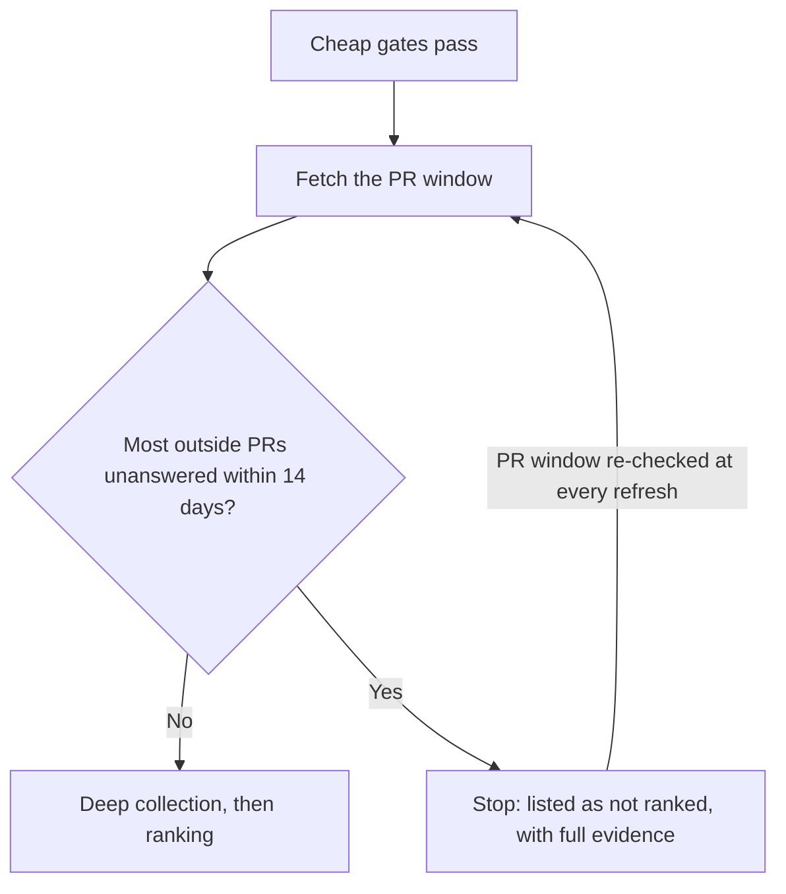
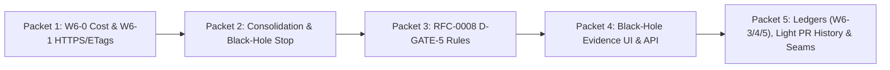

# Porchlamp Scaling Plan — v5 (FROZEN)

> [!CAUTION]
> **FROZEN PLAN — DO NOT MODIFY BY SUBAGENTS**
> This document is frozen as the specification of record. Implementation subagents **must not** edit this file. If a subagent discovers a flaw, edge case, or conflict with existing tests, it must report the finding to the lead agent, who holds sole authority to amend this plan.

> [!IMPORTANT]
> **Bottom line**
> - Today's design keeps only **~10k repos fresh per token per day**, because every change re-fetches whole data windows.
> - We fix that at the current size first. The code is built so growing later is a config change, not a rewrite.
> - Black holes stop costing anything after the verdict, and the site shows how each verdict was reached.

| Topic | Decision (2026-10-14 — Locked) |
|---|---|
| Universe size | **Stay at ~10k for now.** Build the code so it can grow later. |
| Black holes | **Stop deep collection once confirmed.** Keep the name **"Black hole"**, show full evidence on the site, and apply all 5 false-positive reduction rules. |
| Silent closes | **Yes:** a maintainer closing a PR within 14 days counts as a response in `D-GATE-5`. |
| RFCs | **Approved:** `RFC-0008` (Black-hole false-positive rules in `D-GATE-5`) and `RFC-0009` (Light PR history / cohort rules). |
| GitHub App | **Optional, later.** About 15 minutes of your time; not needed at 10k after Phase 2 (Section 6). |
| Google Cloud | **Not now.** Small gain at 10k; a free alternative covers the main gap (Section 7). |

---

## 1. Why 10k already hurts

Each repo that changes triggers a full re-fetch of its data windows (180-day PRs, 365-day commits, and so on).

| Cost per changed repo | Today | After this plan |
|---|---|---|
| GraphQL points | ~14 | ~2 |
| REST calls | ~20 | ~2.4 (after free `304` answers) |
| **Repos one token keeps fresh daily** (40% change per day) | **~10k** | **~72k** |

> [!NOTE]
> "Today" uses the per-collector costs in `docs/v2/08-SUSTAINABLE-COLLECTION.md`, after the governance cap.
> The ~10k result matches what is observed in practice.

---

## 2. What we build now (universe stays ~10k)

| Work | What it saves | Moves scores? |
|---|---|---|
| Finish the HTTPS transport: keep-alive and ETags (W6-1) | ~70–90 ms per call; `304` answers cost no quota | No |
| Collect in gate order, and stop at the black-hole verdict (Section 3) | Deep collection for ~1,600 black holes (about 15% of the 11k universe) | No |
| Fetch a governance file only if the tree lists it | Most of the 12 file fetches per repo | No (identical envelopes) |
| Make `--graphql-bulk` the default | 11–15 REST and 3 search calls per repo | No (same schema; parity check) |
| Compute `commits_180d` from `commits_365d` | Up to 3 REST calls per repo | Almost never (bot detection improves) |
| PR ledger with the settled-PR rule (W6-3) | Re-fetch only new or unanswered PRs | No, if response candidates are stored |
| Issue, commit, release and run ledgers (W6-4) | Whole windows become "since last time" | No (W6-4 acceptance test) |
| Light full PR history replaces per-author searches | CPU-heavy search batches | **Yes:** removes sampling, so it uses an RFC (`RFC-0009`) |
| Black-hole evidence panel and wording (Section 3) | — | No |
| Black-hole false-positive rules (Section 3) | — | **Yes:** refines D-GATE-5, so it uses an RFC (`RFC-0008`) |

**Gate order** means: cheap gate facts first, then the PR window, then deep collectors only for repos that pass.
`--skip-ineligible` already prunes archived, stale and similar repos. Black holes are the missing case.

**The settled-PR rule:** a cheap scan lists PRs updated since the last run, with state and dates only (about 1 point per query).
Only new PRs and open PRs still waiting for an answer get the detailed fetch of reviews and comments.
Store each PR's response candidates, not only the result: D-IN-2 counts a PR merger as a maintainer, and that set changes over time.

**The light PR history:** list every PR once with only number, author, dates and association (1 point per 100 PRs), then add new PRs only.
It answers "did this author have an earlier merge?" for every author, with no search calls.

---

## 3. Black holes: stop early, explain fully

### How it works

- **Stop deep collection once the verdict is confirmed.** Keep refreshing only the PR window, which is cheap with deltas.
- **A project that improves leaves the list at the next refresh.** Its deep data is then collected, and it appears in the ranking 1–2 days later.
- **Nothing else breaks.** The leaderboard, matrix and personas show rated projects only (`porchlamp/store/queries.py`).
  The project page shows the response evidence and marks other pillars "not collected: did not pass the response check".
- **This keeps the current default** (`rank_black_holes=False` in `porchlamp/core/gates.py`).
  The `porchlamp/collect/fingerprint.py` docstring describes the other mode; update it.

### What the site shows (no new API calls)

Today the site shows one sentence per black hole: no numbers and no list. The panel adds:

1. **One factual sentence with numbers**, for example:
   "In the 180 days before 12 Oct 2026, 22 outside pull requests were at least 14 days old.
   14 of them (64%) got no reply, review, close or merge from a maintainer on GitHub within 14 days."
2. **The rule:** 95% Wilson lower confidence bound above 50%, with at least 10 eligible outside pull requests; and what counts as a reply (maintainer comment, review, merge, or close within 14 days).
3. **The counted PRs:** number (linked to GitHub), opened date, first maintainer reply/decision or "none within 14 days". No contributor usernames.
4. **The PRs left out, and why:** bot authors, maintainers' own PRs, PRs under 14 days old, drafts, PRs closed by their own author before any reply, and accounts under 90 days old.
5. **"Think this is wrong?"** How to ask for a re-check, with the known causes:
   - reviews happen elsewhere (Gerrit, mailing list), which the hand-off rule handles;
   - maintainers with private org membership, who count once they merge a PR.

Everything comes from the same recorded PR window, with the same hash, as the verdict itself.

### Wording (Locked)

- **Keep the name `"Black hole"`** on the project page, methodology, and site-wide statistics.
- **Keep the current measured sentence** (`gateReasonText("black_hole")`) compatible with unit tests requiring `"human"`, `"on GitHub"` and `"14 days"`, and forbidding `"never"` and `"stalled"`.
- **Fix the older tooltip** in `web/v2/copy.js` so it matches the measured rule.

### Fewer false positives (`RFC-0008`, changes `D-GATE-5`)

Today `zero_response_counts` (`porchlamp/core/gates.py`) counts drafts, withdrawn PRs and brand-new accounts.

| Rule change | Why | Extra cost |
|---|---|---|
| Leave out drafts (or start the 14-day clock when marked ready for review) | A draft is not asking for review yet | ~1 point per 100 PRs |
| Leave out PRs their author closed before any reply | The author withdrew; nobody was ignored | Small (who closed it) |
| Leave out PRs from accounts under 90 days old at PR creation | Spam and throwaway accounts; D-IN-3 already uses this age rule (`MIN_ACCOUNT_AGE_DAYS = 90`) | None (date is already in the PR data) |
| Count a maintainer closing the PR within 14 days as a response | The contributor gets a visible decision | Small |
| Call it a black hole only when the 95% one-sided Wilson lower confidence bound exceeds 50% | Small samples near 50% are noise | None |

The last rule uses a 95% one-sided Wilson lower confidence bound ($z = 1.6448536269514722$) on the unanswered share. It must be strictly above `0.50` (`GATE5_MAX_ZERO_RESPONSE_SHARE`), with `n >= 10` (`GATE5_MIN_N`):

| Unanswered of counted | Share | 95% Wilson lower bound | Verdict |
|---|---|---|---|
| 6 of 10 | 60% | 0.348 | Borderline (passes gate) |
| 8 of 10 | 80% | 0.538 | Black hole |
| 13 of 20 | 65% | 0.466 | Borderline (passes gate) |
| 14 of 20 | 70% | 0.515 | Black hole |
| 55 of 100 | 55% | 0.468 | Borderline (passes gate) |
| 60 of 100 | 60% | 0.518 | Black hole |

Borderline projects are not gated. They are collected and ranked, and the ghost-rate parameter still scores them 0 (`max(0, 100 − 200 × share)`).

---

## 4. Built to grow, without growing yet

The universe stays the top ~10k repos by stars, built by `scripts/build_universe.py` as today.
"Scalable code" means building these seams now, while they are cheap:

| Seam | Now, at 10k | Later, when growing |
|---|---|---|
| Collection as stages with a queue (list, probe, PR window, deep) | The stages run on today's list | Listing switches to Search, sliced by date |
| One interface for storing envelopes | Files, as today | SQLite shards with the same logical paths |
| Transport with credential slots | One user token | Add the GitHub App token; no code change |
| Scheduler with budgets (W6-7) | One token, daily | More credentials, same scheduler |
| Snapshot build that streams | Same results, less memory | Needed past ~100k repos |
| Static export in pages and shards | Small files anyway | Needed past ~50k ranked repos |

For later, measured on 2026-10-14 with GitHub repository search (all languages):

| Star floor | All repos | Active repos (pushed in 180 days, not archived, fork or mirror) |
|---|---|---|
| 1,000+ | 65,566 | 32,285 |
| 100+ | 483,926 | 154,322 |
| 10+ | 2,903,378 | 606,194 |

Growing means listing the active set with GitHub Search (100 repos per call), then probing gates in batches of 25 repos per GraphQL query.
GH Archive does not work as a radar: it held only ~2% of PR openings (Appendix A).

---

## 5. Capacity: how many repos one token can carry

Assuming 40% of eligible repos change each day:

| Repos needing deep collection | GraphQL per day | REST per day | First full load |
|---|---|---|---|
| 5k (about today's universe) | 4.7k points (4%) | 5.8k (5%) | ~1.2 days |
| 10k | 9.4k points (8%) | 11.6k (10%) | ~2.4 days |
| 50k | 47k points (39%) | 58k (48%) | ~12 days |

| Share of repos changing per day | 20% | 40% | 60% |
|---|---|---|---|
| Repos per token, after this plan | ~124k | ~72k | ~51k |
| Repos per token, today's design | ~20k | ~10k | ~7k |

Today's 11k universe needs deep collection for roughly 3–5k repos (3,321 were ranked on 2026-10-12).
After Phase 2, that is about 5% of one token per day.

---

## 6. GitHub App credential: effort and value

**Owner part (about 15 minutes, once):**
1. GitHub → Settings → Developer settings → GitHub Apps → **New GitHub App**.
2. Give it a name and a homepage URL. Turn off **Webhook → Active**.
3. Permissions, all **read-only**: Metadata (always on), Contents, Pull requests, Issues, Actions, Checks, Commit statuses.
4. Create it, then click **Generate a private key**. A `.pem` file downloads.
5. **Install** it on your account. One repo is enough.
   Installing on all your repos adds 50 points per hour for each repo over 20, up to 12,500 per hour.
6. Share the App ID and the installation ID. Keep the `.pem` on the collector machine (`chmod 600`, never committed).

**Engineering part (a small packet):**
- Sign a short token with the private key, using the `openssl` command (Python's standard library cannot do RSA signing).
- Exchange it for a 1-hour installation token, and refresh it before it expires.
- Let the transport send work to whichever credential has more budget left.
- Desktop only; the phone keeps the user token.

**Value:**

| When | Worth it? |
|---|---|
| At 10k, after Phase 2 | No. About 5% of one token per day. |
| Before Phase 2 | Somewhat: a full refresh takes half the time. |
| When growing | Yes. It is the first step past ~70k eligible repos. |

---

## 7. Google Cloud: having it vs not

Neither choice changes GitHub API cost, which is the real bottleneck.

| | With Google Cloud (BigQuery sandbox) | Without |
|---|---|---|
| Setup | ~20 minutes; no credit card or billing account | None |
| Finding a repo's packages for very popular repos | Complete deps.dev mapping; says whether each link is verified | ecosyste.ms lookup by repo URL covers most cases (tested: `windows-rs` → `windows`, 665 dependents); metadata links only |
| PyPI downloads | One query a month | pypistats in the background: ~6–8 hours a week at 10k, no GitHub quota |
| Ongoing work | One more credential, a query job, extract envelopes for provenance | None |
| Limits | 1 TiB of queries a month; 10 GiB storage for life; tables expire after 60 days | pypistats: 4 requests a minute (~5.7k packages a day) |
| Data license | deps.dev data is CC BY 4.0 (credit on the site) | ecosyste.ms data is CC BY-SA 4.0, as today |

**Recommendation: not now.** Fill the 1,500-version gap with the ecosyste.ms lookup first.

---

## 8. Guardrails & Security Verification Plan

### Porchlamp Data & Methodology Guardrails
- **Provenance stays "envelope path plus content hash".** Each bulk or third-party source becomes a small per-repo extract envelope.
- **Never prune on missing data.** An unresolved repo counts as dirty, never clean. This is already the rule.
- **Parity before switching.** Run the old and new collectors on the same repos at one `as_of`.
  The derived bundles must match, or the difference is documented (with an RFC if scores move).
- **Daily audit sample.** Fully re-fetch 0.5% of eligible repos and compare them with the ledger values (feeds `source_drift`).
- **Standard library only** (the phone needs it): `sqlite3`, `zlib`, `http.client`.
- **Respect GitHub's limits.** Fewer than 100 concurrent requests, and under 60 s of GraphQL CPU per minute.
  Read budgets from response headers (D-COL-13).

### Security Verification Plan
- **Frontend XSS Prevention (`web/v2/`):** All new DOM rendering for the Black-Hole evidence panel must use safe DOM construction (`document.createElement`, `textContent`, `setAttribute`, `replaceChildren`) or explicit HTML escaping (`esc()` in `web/v2/dom.js`); never inject unescaped external strings (repo names, PR numbers, dates, or exclusions) into HTML sinks, and validate external GitHub PR links to strictly match `https://github.com/<owner>/<name>/pull/<int>`.
- **PII / Contributor Privacy:** Never store or display contributor GitHub usernames/logins in the public Black-Hole evidence panel — expose only PR number (`#123`), creation timestamp, and maintainer response/decision status.
- **Path & File System Security (`porchlamp/collect/`, `porchlamp/store/`):** Validate `owner` and `name` slug components against traversal sequences (`..`, `/`, `\`) before constructing envelope or ledger file paths.
- **Secrets & Credentials (`porchlamp/collect/ghcli.py`):** Never hardcode tokens or log `Authorization` headers in `gather-cost.jsonl`, error messages, or envelopes.
- **Database Parameterization (`porchlamp/store/`):** Use parameterized SQLite queries (`?` placeholders) exclusively; never concatenate user input into SQL strings.
- **Testing & Localhost Binding:** Any test HTTP servers must bind exclusively to `127.0.0.1` / `localhost`, never `0.0.0.0`.
- **Not-Applicable Web App Controls:** Porchlamp is a read-only public benchmark and static export without user accounts, passwords, logins, sessions, cookies, or file uploads (`TODO(security): authentication, session management, CSRF, and file-upload controls are not applicable to this read-only public static/API benchmark`).

---

## 9. Roadmap & Implementation Packets

| Packet | Scope | Verification |
|---|---|---|
| **Packet 1** | W6-0 per-(repo, collector) cost accounting (`gather-cost.jsonl` + summary helper) & W6-1 persistent `http.client` keep-alive connection pooling + `If-None-Match` ETag `304` cache + default `PORCHLAMP_GH=http` | Unit tests for connection reuse, `304` fallback to cached envelope without quota consumption, and cost log emission |
| **Packet 2** | Derive `commits_180d` from `commits_365d`; tree-gate `governance.py` file fetches; `--graphql-bulk` default in `scripts/gather.py`; stop downstream deep collectors (`governance`, `commits_365d`, `author_history`) on confirmed `black_hole` while keeping `pr_window` refresh active; `scripts/derive.py --all --workers N` | Unit tests for `commits_180d` derivation, tree-gated governance, black-hole pruning in `fingerprint.py` / `gather.py`, and batch derive |
| **Packet 3** | File `RFC-0008` for `D-GATE-5` false-positive rules (draft exclusion, author self-close exclusion, `< 90d` account age exclusion, maintainer close within 14d as response, 95% Wilson lower bound > 0.50); update `constants_v2.py`, `gates.py`, `github_graphql.py`, `gate_evidence.py`, `methodology.py`; re-pin `CONSTANTS_HASH` and regenerate `docs/METHODOLOGY-v2.md` | `tests/core/test_frozen.py`, `tests/core/test_gates.py`, `tests/test_render_methodology.py`, and fixture snapshot update |
| **Packet 4** | Expose structured `D-GATE-5` determination breakdown (counted PRs with number, opened date, response/decision status, no usernames; excluded counts by reason; Wilson bound) in API & static export; render Black-Hole evidence panel in `web/v2/` while keeping label `"Black hole"` and fixing `SUSPICION_FLAG_COPY.black_hole` | `node --test web/v2/tests/*.mjs`, `pytest tests/serve/`, and `scripts/verify_static_export.py` |
| **Packet 5** | Delta ledgers (`porchlamp/collect/ledger.py` for W6-3 settled-PR rule, W6-4 issue/commit/release/run ledgers, W6-5 light PR history + `RFC-0009`) and scalable seams (stage queue, envelope-store abstraction, credential-slot pool, streaming snapshot build) | Full `pytest` and `node --test` suites green |

---

## 10. Resolved Decisions (2026-10-14)

1. **Label on a black-hole project's page:** Keep **"Black hole"**.
2. **Silent closes:** **Yes**, a maintainer closing a PR within 14 days counts as a response.
3. **RFCs approved:** Both the black-hole false-positive rules (`RFC-0008`) and the light PR history (`RFC-0009`) are approved for implementation.
4. **GitHub App:** Deferred until needed past 10k.

---

## Appendix A: What v2 got wrong

| v2 claim | What we found | Change |
|---|---|---|
| GH Archive lists every repo with a push or PR | It held 34 of 1,926 PR openings (2%), across the 6 busiest repos over 4 hours | Dropped as the radar |
| GH Archive payloads are only slightly trimmed | PR objects keep only `id`, `number`, `base`, `head`, `url`; pushes carry no commits; hourly files shrank from 77 MB (2024) to 14 MB (2026) | The W6-10 replay refuses these events; park it |
| Bulk datasets exist for all package data | Scorecard BigQuery is gone, npm bulk fails, the ecosyste.ms dump is from February | Per-package APIs, for eligible repos only |
| Replace the `gh` subprocesses | An HTTPS transport already exists; it lacks keep-alive and ETags | Finish it (reused connection 41 ms versus 110–130 ms for a new one) |
| The ranked set is bounded at 60–80k | Guessed; repos with 1–9 outside PRs can still be rated | Measure before growing |
| Skipping black holes saves 37% | 37% of active repos, about 15% of the universe | Decided: stop after the verdict |
| A repo with 500 PRs or fewer needs no author searches | `pr_window` covers only 180 days | Light full PR history |
| Prune repos with no human push in 180 days | Merge-queue repos push as bots and would be wrongly gated | Prune only on `pushed_at` older than 180 days |
| Use Zstd shards and `httpx` | Not in the standard library; the phone needs it | `sqlite3`, `zlib`, `http.client` |
| Delete `commits_180d` | D-GATE-4 evidence, pruning and audits read it | Compute it from `commits_365d` |
| 10k in 4–6 hours | No basis | Computed model; W6-0 to measure |

## Appendix B: Evidence

| Check | Result | Source |
|---|---|---|
| GH Archive sample (4 hours, 2026-10-13) | 182,778 repos with events; 3,404 with PR events by people; 31% of PR events from bots | `gharchive_sample.py` |
| GH Archive completeness | 2% of PR openings captured | `gharchive_completeness.py` |
| Active-set sizes | Table in Section 4 | GitHub search `total_count` |
| HTTPS cost | New connection 110–130 ms; reused 41 ms | `curl -w` against `api.github.com` |
| GitHub limits | 5,000 points/hour; App installs 5,000–12,500; under 100 concurrent; 60 s GraphQL CPU per minute; `304` free | GitHub rate-limit docs |
| D-GATE-5 today | Drafts, withdrawn PRs and new accounts count; a silent close is not a response | `porchlamp/core/gates.py`; no `isDraft` in the PR query |
| Site today | One sentence per black hole; tooltip uses older wording | `web/v2/copy.js` |
| BigQuery sandbox | No card; 1 TiB queries a month; 10 GiB lifetime storage; tables expire after 60 days | Google Cloud docs |
| ecosyste.ms reverse lookup | Works; returns packages and dependents per repo URL | `curl` test |
| Capacity numbers | Section 5 tables | `capacity_model.py` |
